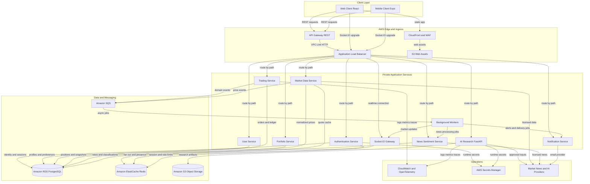
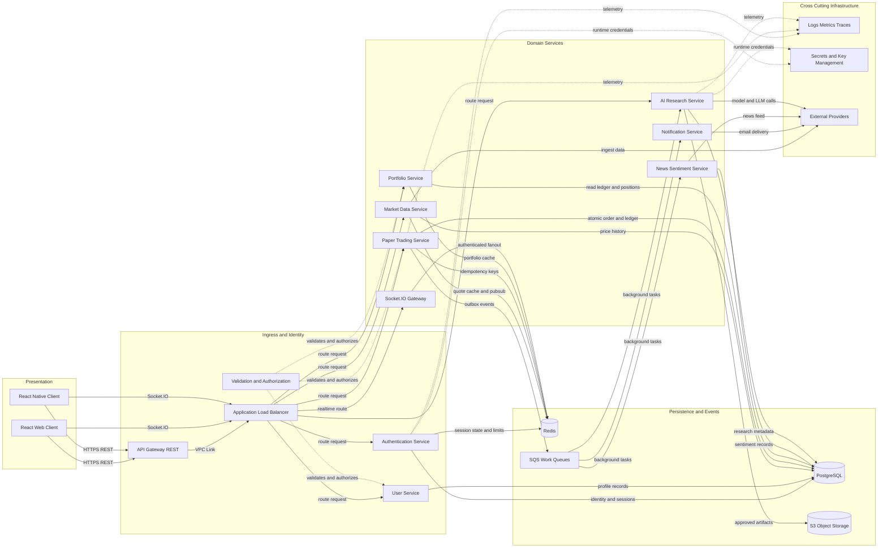

# Architecture Diagram

Asteriq AI uses a shared, authenticated backend for React web and React Native clients. The design separates synchronous account and paper-trading operations from asynchronous market-data, notification, and AI workloads; all trading is simulated and no real-money orders are routed.

## Application Architecture

<!-- mermaid-checked: no \n, no em-dash/en-dash, no {} in labels, subgraphs are id["label"], arrows are -->|"label"|, all subgraphs closed by end, ids unique -->


### Technology Stack Summary

| Layer | Technology | Version | Purpose |
|---|---|---|---|
| Web client | React, TypeScript, Vite, Tailwind CSS | Pin supported versions in lockfiles | Responsive browser product; calls shared REST API and Socket.IO gateway |
| Mobile client | React Native, Expo, TypeScript | Pin supported versions in lockfiles | iOS and Android product using the same backend contracts |
| Edge | Amazon CloudFront, AWS WAF | Managed AWS services | Static content delivery, edge protections, and optional API acceleration |
| REST ingress | Amazon API Gateway HTTP API | Managed AWS service | Public REST entry, quotas, throttling, request routing through VPC Link |
| Application ingress | Application Load Balancer | Managed AWS service | Private service routing and Socket.IO HTTP upgrade support |
| Backend | Node.js, Express, TypeScript | Supported LTS runtime | Authentication, user, market, paper-trading, portfolio, notification, and realtime services |
| AI backend | Python, FastAPI | Supported Python release | AI research and model/provider integration |
| AI and NLP libraries | scikit-learn, Hugging Face, LangChain, OpenAI API | Pin and evaluate versions | News classification, retrieval/orchestration, and generated research summaries |
| Realtime | Socket.IO | Compatible client/server versions | Authenticated quote, portfolio, order, alert, and notification updates |
| Primary database | Amazon RDS for PostgreSQL, Multi-AZ | Select supported engine version | System of record for users, paper accounts, orders, immutable ledger, and domain records |
| Cache and coordination | Amazon ElastiCache for Redis | Select supported engine version | Quote cache, rate-limit counters, ephemeral coordination, Socket.IO adapter |
| Asynchronous messaging | Amazon SQS | Managed AWS service | Durable work queues for notifications, alerts, news, and AI jobs |
| Object storage | Amazon S3 | Managed AWS service | Versioned research artifacts, exports, and permitted source documents |
| Compute | Amazon ECS on AWS Fargate | Managed container runtime | Independently scaled API and worker services in private subnets |
| Containers and delivery | Docker, Docker Compose, GitHub Actions | Pin toolchain versions | Local reproducibility, CI checks, image build and deployment |
| Monitoring | Amazon CloudWatch, OpenTelemetry | Managed plus open standard | Logs, metrics, traces, dashboards, and alerting |
| Secrets | AWS Secrets Manager and KMS | Managed AWS services | Rotation-capable secret storage and key management |

### Data Storage & External Services

PostgreSQL is authoritative for identity, paper orders, transaction-ledger entries, alerts, and portfolio records; portfolio snapshots are rebuildable projections. Redis is a disposable cache and coordination layer, never the financial ledger. SQS separates durable asynchronous work from user-facing requests. S3 stores only approved artifacts with encryption, lifecycle rules, and access controls. Market-data, news, email, and AI providers sit behind adapters; provider licensing, retention, and outbound data-sharing terms must be reviewed before enabling them.

### Key Architectural Decisions

- Both clients use one versioned REST contract and one authenticated Socket.IO service; domain rules and execution prices are enforced server-side.
- Use API Gateway for REST and an Application Load Balancer for Socket.IO. Socket.IO may use HTTP long-polling and its own upgrade protocol; API Gateway's native WebSocket API is a different protocol and should not be substituted without a deliberate client/server redesign.
- Deploy Node.js API/realtime services, Python AI services, and workers as separately scalable containers. Use the transactional ledger plus an outbox/queue pattern for reliable paper-order side effects.

## Component Relationships

<!-- mermaid-checked: no \n, no em-dash/en-dash, no {} in labels, subgraphs are id["label"], arrows are -->|"label"|, all subgraphs closed by end, ids unique -->


### Component Inventory

| Component | Layer | Type | Responsibility |
|---|---|---|---|
| Web Client | Presentation | React SPA | Browser user experience; calls the shared REST and Socket.IO APIs |
| Mobile Client | Presentation | React Native app | Native mobile user experience using the same API contracts |
| API Gateway | Ingress | AWS managed HTTP API | REST entry, throttling, request limits, routing, and VPC Link |
| Application Load Balancer | Ingress | AWS managed load balancer | Routes to private services and supports Socket.IO HTTP connections/upgrades |
| Authentication Service | Identity | Node.js service/module | Registration, verification, login, refresh, revocation, and credential recovery |
| User Service | Domain | Node.js service/module | User profile, preferences, consent records, and account lifecycle |
| Market Data Service | Domain | Node.js service/worker | Provider normalization, quote freshness, instrument catalog, and price history |
| Trading Service | Domain | Node.js service | Validates and simulates paper orders; atomically records order and ledger entries |
| Portfolio Service | Domain | Node.js service | Calculates ledger-backed holdings, cash, valuation, and P/L projections |
| Notification Service | Domain | Node.js service/worker | In-app and email notification preferences, templates, retries, and delivery state |
| AI Research Service | AI | Python FastAPI service | Generates source-grounded educational summaries and descriptive portfolio insights |
| News Sentiment Service | AI/data | Python or Node.js worker | Ingests approved news, links instruments, runs sentiment model, and stores provenance |
| Socket.IO Gateway | Realtime | Node.js service | Authenticates connections and publishes authorized updates to clients |
| PostgreSQL | Persistence | Relational database | Authoritative account, transaction, order, news, alert, and research metadata store |
| Redis | Cache/coordination | In-memory data store | Cache, rate limits, ephemeral session data, and Socket.IO cross-instance adapter |
| SQS Work Queues | Messaging | Managed queue | Durable asynchronous jobs with retry, dead-letter, and redrive policies |
| S3 Object Storage | Persistence | Object store | Encrypted storage for approved exports and research artifacts |
| Validation and Authorization | Cross-cutting | Middleware/library | Schema validation, identity enforcement, object-level authorization, and request limits |
| Logs Metrics Traces | Operations | Observability stack | Service health, latency, queue state, security signals, and trace correlation |
| Secrets and Key Management | Security | AWS managed services | Secret retrieval, encryption keys, rotation, and access policy |
| External Providers | Integration | Provider adapters | Market data, news, AI/LLM, and email integrations with explicit timeout and fallback behavior |

## Request Flow

1. The web application is served as static assets from S3 through CloudFront. The mobile application is distributed through its app channel. Both call the same public REST API and Socket.IO endpoint.
2. REST requests pass through CloudFront/WAF where configured, then API Gateway applies throttling, quotas, and request-size limits.
3. API Gateway uses a VPC Link to reach the private Application Load Balancer. The ALB routes by host/path to the appropriate service or shared Node.js API deployment.
4. Authentication middleware validates the access credential, then authorization checks that the authenticated user owns the requested object. Inputs are validated against schemas before domain logic executes.
5. Domain services read/write PostgreSQL, use Redis only for eligible cache/coordination, and enqueue non-critical or long-running work to SQS.
6. Responses include a request ID, stable error shape, and explicit timestamp/currency/data-status metadata where relevant.

The services may initially be modules in a modular Node.js application deployed as one or a few containers. Keep service boundaries in code and contracts; split into independently deployed services as team ownership, load, or fault isolation warrants. This avoids operating a large microservice fleet before the product requires it.

## Authentication Flow

1. Registration validates and normalizes email, securely hashes the password, creates a pending user, and queues an email-verification message.
2. Verification uses an expiring, single-use token. The token is stored hashed and is never logged or placed in analytics.
3. Login performs generic failure responses, rate limiting, password verification, and optional risk checks. The service issues short-lived access credentials and a rotating refresh credential.
4. For web, prefer Secure, HttpOnly, SameSite cookies with CSRF protection for state-changing requests. For mobile, store refresh credentials in iOS Keychain/Android Keystore-backed secure storage; keep access credentials short-lived and memory-resident where practical.
5. REST middleware validates signature, expiry, issuer, and audience, then loads or validates the user/session state. Authorization is enforced for every account-owned resource.
6. Socket.IO authenticates during handshake, binds the connection to a user/session, and authorizes each room subscription. Revocation/expiry disconnects or revalidates live sessions.
7. Logout revokes the refresh/session record and associated realtime sessions. Password reset uses an expiring, single-use token and invalidates active sessions according to policy.

Identity tokens must not be accepted as authorization by themselves for a user-owned resource. Use object-level permission checks on every API and realtime subscription.

## Trading Flow

1. Client submits a buy or sell market order with instrument ID, quantity, account ID, and an idempotency key. It does not submit an authoritative execution price.
2. Trading service authenticates and authorizes the account, checks instrument eligibility and quantity, then obtains a quote accepted by the execution policy. If the quote is stale/unavailable, return a stable rejection rather than silently using an old value.
3. In a PostgreSQL transaction, lock or otherwise safely serialize the affected account/position, revalidate virtual cash or sellable holdings, persist the order transition, and post immutable ledger entries. Enforce a unique idempotency constraint in durable storage.
4. Commit the transaction and an outbox event atomically. An outbox publisher sends the order/portfolio update to SQS or an event channel for notification and realtime fanout.
5. Portfolio projections update from ledger events and remain rebuildable. The synchronous response returns authoritative order status and execution details; clients may also receive a Socket.IO update.
6. Duplicate retries return the prior result. Failed transactions create no partial balance, holding, or ledger mutation. A reconciliation worker compares projections to ledger state and pages/alerts on invariant breaches.

Market-order fills use a documented simulated execution rule (quote source, timestamp, rounding, any simulated slippage/fees, and market-session behavior). The service always labels execution as paper/simulated.

## Real-Time Market Price Flow

1. Market data adapters ingest licensed provider observations or generate clearly labeled simulated observations according to the selected mode.
2. Validate schema, instrument mapping, currency, timestamp, source, and outlier/freshness constraints. Persist required historical observations to PostgreSQL and cache the current quote with a bounded TTL in Redis.
3. Publish normalized quote events to a durable or replayable internal channel where required, then route updates to Socket.IO gateway instances. Redis Pub/Sub/Socket.IO adapter may fan out across ECS tasks; it is not the durable source of truth.
4. Socket.IO gateway authorizes subscriptions, applies per-connection and per-user limits, and sends quote updates with source, status, currency, and event timestamp.
5. On disconnect or detected gaps, clients fetch a REST snapshot and resume subscriptions. The UI shows stale/disconnected status and does not assume delivery exactly once.

For durable replay, audit, or high-volume ingestion, use Kinesis Data Streams or MSK only after throughput and replay requirements justify the added operational complexity. Redis Pub/Sub alone is best-effort and should not be used as the only record of prices or financial events.

## AI Research Flow

1. Client requests a summary for an allowed instrument, market topic, or portfolio view through the shared API.
2. API authenticates the user, applies quotas and consent/policy checks, selects only necessary data, and creates a research job or bounded synchronous request.
3. AI Research Service retrieves approved, timestamped internal data and licensed source material. It records provenance and treats retrieved content as untrusted input.
4. A provider adapter calls the configured model with versioned prompts and strict timeouts. Output checks reject unsupported guaranteed returns, direct execution instructions, or disallowed advice. Provider credentials remain in Secrets Manager.
5. Store output and metadata according to retention policy: model/provider and prompt versions, input time range, source references, generation time, and safety status. Store larger permitted documents/artifacts in S3.
6. Return a clearly labeled educational summary with available citations and data freshness. If sources are insufficient or the model/provider is unavailable, return an explicit unavailable/pending response; core portfolio and paper-trading flows remain available.

Portfolio insights should be descriptive rather than personalized recommendations. Do not send credentials, unnecessary personal data, or full transaction history to an external model. Apply provider retention and training opt-out settings where available and verify contractual terms.

## Database Flow

- PostgreSQL is the source of truth. The Trading Service owns order and ledger writes; Portfolio Service reads the ledger and maintains rebuildable projections.
- Use SQL transactions, unique constraints, foreign keys, decimal-safe amounts, and row-level concurrency control for order processing.
- Publish side effects through a transactional outbox to avoid the dual-write failure between a committed order and a lost queue/event.
- Use schema migrations in CI/CD with backward-compatible rollout where feasible; take automated encrypted backups and regularly test restores.
- Use read replicas for read-heavy workloads only after measuring demand and accounting for replication lag. Financial decision reads and order validation must use a consistency-safe path.
- Partition/archive high-volume price history and event data based on retention and measured query patterns. Keep retention requirements separate for account, audit, market, and AI data.
- Avoid using Redis as a fallback source of balances or holdings. A cache miss should load authoritative data or return a service error.

## Caching Strategy

| Data | Cache policy | Source of truth / invalidation |
|---|---|---|
| Current market quote | Redis TTL based on source and freshness policy; key includes instrument and source/status | Provider/market observation store; update on accepted observation |
| Instrument catalog | Longer TTL; invalidate on catalog update | PostgreSQL or provider master data |
| Public news metadata | Short TTL, subject to provider license | Approved news store/provider |
| User profile/preferences | Short TTL only if measured useful; invalidate on mutation | PostgreSQL |
| Portfolio view | Short TTL or event-invalidated projection; always return valuation timestamp | Ledger and portfolio projection tables |
| Session/revocation state | Short-lived or durable session design with explicit revocation semantics | Authentication/session store |
| Rate limits and idempotency | Rate counters in Redis; financial idempotency also enforced durably in PostgreSQL | Redis for counters; PostgreSQL unique key for orders |
| AI responses | Cache only when inputs, authorization, model version, and freshness permit; never leak one user's private portfolio result to another | Research record with cache key bound to privacy and provenance |

No cache entry may authorize access. Cache failures should degrade read performance or cause explicit service errors, not weaken authorization or financial correctness.

## Failure Handling

| Failure | Required behavior |
|---|---|
| Market-data provider unavailable | Mark quotes stale/unavailable, open circuit breaker, retain last observation only with its original timestamp, and reject orders if the execution policy requires a fresh quote |
| Redis unavailable | Continue from PostgreSQL for safe reads where possible; disable nonessential cache-dependent paths; do not accept stale auth state or bypass durable idempotency |
| PostgreSQL unavailable | Fail closed for order/account mutations; return retriable service error; queue only operations that can safely be processed later |
| Duplicate order request | Return the result associated with the durable idempotency key; never create a second fill |
| SQS/worker failure | Retry with bounded exponential backoff and jitter; route poison messages to DLQ; alert on queue age/depth; provide safe redrive tooling |
| Socket.IO disconnection | Clients show disconnected status, reconnect with backoff, resubscribe, and REST-resynchronize snapshots |
| AI provider timeout or unsafe output | Enforce timeout/circuit breaker, return explicit pending/unavailable result, record provider health, and leave core app features available |
| Email provider failure | Persist delivery status, retry asynchronously, prevent duplicate sends where possible, and expose operational failure without exposing tokens |
| ECS task/availability-zone failure | Replace unhealthy tasks, keep service capacity across multiple AZs, and use readiness checks to avoid routing traffic prematurely |
| Bad deployment | Health-gated rollout, rapid rollback to prior image/task definition, backward-compatible schema changes, and post-deploy smoke tests |
| Data inconsistency | Stop affected order path if ledger invariants fail, preserve immutable evidence, alert on-call, reconcile from ledger, and use compensating entries rather than editing history |

Apply timeouts, bounded retries, exponential backoff with jitter, circuit breakers for external dependencies, bulkheads for expensive AI work, and clear request correlation IDs. Avoid broad retries on order submissions unless the request uses an idempotency key.

## Scaling Strategy

- **Web assets:** CloudFront caches versioned static assets from S3; mobile binaries are distributed through the relevant app stores.
- **API:** Scale ECS Fargate services horizontally using CPU/memory and request-latency/concurrency signals. Keep request handlers stateless and use connection pooling suitable for RDS limits.
- **Domain boundaries:** Initially use a modular Node.js backend if operational simplicity matters. Split Market Data, Trading, Portfolio, Notifications, and Socket.IO into separate deployable services when separate scaling, team ownership, or failure isolation benefits are measurable.
- **AI:** Run FastAPI and model workers in separate ECS services with dedicated autoscaling, queue-based admission control, strict provider quotas, and concurrency limits. Use managed GPU inference only if model latency/volume and cost justify it.
- **Realtime:** Scale Socket.IO tasks horizontally behind ALB; configure health checks and a compatible cross-instance adapter such as ElastiCache Redis. Load-test long polling, websocket upgrades, reconnect storms, and fanout.
- **Database:** Start with Multi-AZ RDS PostgreSQL and connection pooling. Optimize queries/indexes and projections before adding read replicas; consider Aurora PostgreSQL only after workload and operational requirements are evaluated.
- **Queues:** Scale workers on queue depth and oldest-message age. Apply per-queue concurrency limits so news or AI bursts cannot starve notifications or other work.
- **Market data:** Partition ingestion by provider/instrument group as load grows; use durable streaming infrastructure only when replay and throughput requirements demand it.
- **Global availability:** Begin in one AWS region with multi-AZ resilience. Add multi-region reads or active/passive recovery only after data residency, consistency, recovery objectives, and operating cost are addressed.
- **Capacity planning:** Load-test realistic authenticated read/write mixes, market-update fanout, queue spikes, AI concurrency, and concurrent orders. Establish per-user quotas and cost alarms.

## Recommended Folder Structure

```text
asteriq-ai/
  apps/
    web/
      src/
        app/
        components/
        features/
          auth/
          discovery/
          portfolio/
          paper-trading/
          watchlists/
          research/
        api/
        realtime/
        styles/
    mobile/
      app/
      src/
        components/
        features/
        navigation/
        api/
        realtime/
        storage/
  services/
    api/
      src/
        modules/
          auth/
          users/
          instruments/
          market-data/
          trading/
          portfolio/
          watchlists/
          alerts/
          notifications/
          research/
        middleware/
        infrastructure/
        jobs/
        app.ts
        server.ts
    realtime/
      src/
        auth/
        subscriptions/
        adapters/
        server.ts
    ai/
      app/
        api/
        research/
        sentiment/
        providers/
        safety/
        schemas/
      tests/
    workers/
      src/
        market-ingestion/
        alert-evaluator/
        notification-delivery/
        news-processing/
        research-jobs/
  packages/
    api-contracts/
    shared-types/
    eslint-config/
    tsconfig/
  database/
    migrations/
    seeds/
    queries/
  infra/
    terraform-or-cdk/
      environments/
      modules/
  deploy/
    docker/
    compose/
  tests/
    contract/
    integration/
    e2e/
  .github/
    workflows/
  package.json
  pnpm-workspace.yaml
  docker-compose.yml
  README.md
```

Keep `packages/api-contracts` generated from or validated against OpenAPI. Do not share server-side business logic with mobile/web; clients share types and contracts, while the server remains authoritative. The API and realtime gateway may be combined initially if they share deployment/lifecycle needs, but should have clear module boundaries.

## Communication Patterns

| Interaction | Pattern | Notes |
|---|---|---|
| Web/mobile to backend | HTTPS REST/JSON | OpenAPI contracts, bearer or secure-cookie session strategy, stable errors, pagination |
| Web/mobile to realtime | Socket.IO over TLS | Same identity/session system; per-subscription authorization; REST snapshot recovery |
| API to domain services | In-process calls initially; internal HTTP/gRPC only when separately deployed | Keep ownership boundaries and avoid synchronous service chains for noncritical work |
| Trading to persistence | PostgreSQL transaction | Atomic order, ledger, idempotency, and outbox write |
| Domain event to worker | Transactional outbox plus SQS | At-least-once delivery; consumers must be idempotent |
| Market ingestion to fanout | Normalized event plus Redis adapter or durable stream | Redis Pub/Sub is best-effort; durable stream only if replay is needed |
| Worker to notification provider | Asynchronous adapter call | Timeouts, retries, delivery status, DLQ |
| AI service to model/data providers | Internal authenticated service call plus external HTTPS | Minimize data, enforce quotas/timeouts, record provenance |
| Services to telemetry | OpenTelemetry/log/metrics export | Correlation IDs; redact sensitive fields |

## AWS Deployment Architecture

### Network and ingress

- Use a dedicated VPC across at least two Availability Zones for production.
- Put CloudFront, AWS WAF, and Route 53 at the public edge; place API Gateway REST ingress behind a custom domain and WAF policy.
- Connect API Gateway HTTP API to the private Application Load Balancer using VPC Link. Route REST paths to private ECS services.
- Expose a dedicated Socket.IO hostname/path through the Application Load Balancer with TLS termination and websocket upgrade support. Restrict direct origin access; use WAF and security groups. Ensure Socket.IO polling fallback, upgrade, timeouts, and session affinity behavior are tested with the chosen ALB/ECS setup.
- Run ECS Fargate tasks in private subnets. Use NAT gateways or controlled egress for approved external market, AI, news, and email providers; consider VPC endpoints for AWS services.
- Use security groups with least-privilege service-to-service access. Do not assign public IPs to application tasks or databases.

### Compute and managed services

- ECS Fargate services: API/domain services, Socket.IO gateway, Python AI service, and independent workers. Set separate task roles, autoscaling policies, health checks, and deployment strategies.
- RDS PostgreSQL Multi-AZ in private database subnets with encryption, automated backups, point-in-time recovery, monitoring, and connection pooling.
- ElastiCache Redis in private subnets, configured for high availability where cache/coordination availability warrants it. Define eviction policy and avoid treating Redis as durable storage.
- SQS queues per workload class with dead-letter queues, visibility timeout aligned with job execution, encryption, and alarms on oldest-message age.
- S3 buckets with block-public-access, KMS encryption, versioning where useful, lifecycle policies, and narrowly scoped task roles.
- CloudWatch logs/metrics/alarms, AWS X-Ray or OpenTelemetry-compatible tracing, CloudTrail, GuardDuty, and Security Hub according to organizational security posture.
- AWS Secrets Manager for external provider keys and database credentials; KMS for encryption key control and rotation policies.
- ECR for immutable container images, vulnerability scanning, lifecycle cleanup, and task definitions pinned to approved image digests.

### Delivery pipeline

1. GitHub Actions runs formatting, lint, type-check, unit and contract tests, database migration checks, dependency scans, and container scans.
2. Build versioned container images and publish to ECR using short-lived GitHub-to-AWS federation (OIDC), not long-lived AWS keys.
3. Deploy infrastructure through reviewed Terraform or AWS CDK changes; deploy ECS task definitions using staged rollout and health checks.
4. Run migration and smoke-test steps with backward-compatible schema changes; gate production promotion on health and operational alarms.
5. Keep dev, staging, and production AWS accounts/environments separated where practical, with environment-specific IAM roles, secrets, data, and approval controls.

### AWS topology summary

```text
Users
  -> Route 53
  -> CloudFront and WAF
      -> S3 web assets
      -> API Gateway HTTP API -> VPC Link -> private ALB -> ECS services
      -> Socket.IO hostname -> private-origin ALB -> ECS Socket.IO tasks
                                      |
                         Private application subnets
                           ECS API / AI / workers
                              |       |       |
                         RDS PostgreSQL Redis  SQS
                              |               |
                             S3         worker tasks

Observability: CloudWatch, OpenTelemetry, CloudTrail
Secrets and keys: Secrets Manager, KMS
External access: controlled egress to approved data, AI, and email providers
```

The topology is a reference design, not a deployment of resources. Before production, finalize AWS region, data-provider rights, target traffic, service-level objectives, recovery objectives, data retention, and expected AI/provider spend.
