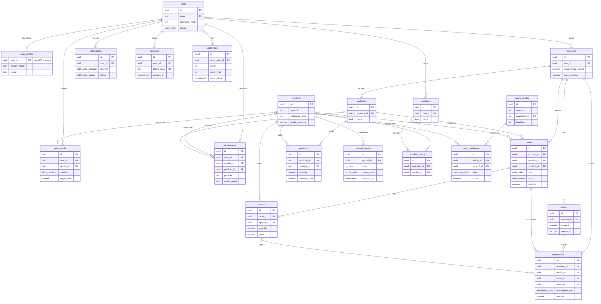

# Data Architecture & Persistence Layer

Asteriq AI's planned persistence layer uses PostgreSQL for 20 relational entities covering identity, simulated accounts, trading records, market observations, and AI/news metadata. The repository uses the Node.js `pg` driver directly; SQL migrations in `database/migrations` define the intended schema and are not yet executed automatically by the API.

## Database Configuration

| Service/Module | DB Type        | Profile           | Driver       | Connection                          | Migration Tool                                          |
| -------------- | -------------- | ----------------- | ------------ | ----------------------------------- | ------------------------------------------------------- |
| API            | PostgreSQL     | Local development | Node `pg`    | `DATABASE_URL` environment variable | Numbered SQL migration; API does not yet run migrations |
| API            | Redis          | Local development | Node `redis` | `REDIS_URL` environment variable    | Not applicable                                          |
| AI service     | None currently | All               | None         | No database connection implemented  | Not applicable                                          |

The root environment template provides a local PostgreSQL and Redis connection. No production profile, pool sizing, ORM, or migration runner is configured in the current application. The database design and exact connection/migration guidance are documented in [database-design.md](../../../../docs/database-design.md).

## Data Ownership per Service

| Service              | Tables Owned                                              | ORM Framework            | Caching                                                | Notes                                                         |
| -------------------- | --------------------------------------------------------- | ------------------------ | ------------------------------------------------------ | ------------------------------------------------------------- |
| Identity             | `users`, `user_profiles`, `sessions`                      | None; planned direct SQL | Redis connection exists; session cache not implemented | Password/session handling is not implemented                  |
| Paper trading        | `accounts`, `wallets`, `orders`, `trades`, `transactions` | None; planned direct SQL | Redis connection exists; no business cache implemented | Paper-only. Transactions are the virtual cash ledger          |
| Portfolio            | `portfolios`, `positions`                                 | None; planned direct SQL | Not implemented                                        | Position records are projections derived from simulated fills |
| Market data          | `symbols`, `market_quotes`                                | None; planned direct SQL | Redis connection exists; quote cache not implemented   | Quote state must distinguish simulated/delayed/realtime/stale |
| Discovery and alerts | `watchlists`, `watchlist_items`, `price_alerts`           | None; planned direct SQL | Not implemented                                        | User-owned preferences                                        |
| Notifications        | `notifications`                                           | None; planned direct SQL | Not implemented                                        | Delivery workers are not implemented                          |
| Research and news    | `ai_research`, `news_articles`, `news_sentiment`          | None; planned direct SQL | Not implemented                                        | AI service currently exposes health checks only               |
| Platform security    | `audit_logs`                                              | None; planned direct SQL | Not applicable                                         | Audit writes and access controls are not yet wired            |

## Entity Model

<!-- mermaid-checked: every attribute is `<type> <name> [<key>] ["<description>"]` with at most one of PK/FK/UK, no \n in descriptions, no {} in descriptions, every relationship label is double-quoted -->

The complete column-level catalog, constraints, and relationship descriptions are in [database-design.md](../../../../docs/database-design.md). SQL source is [001_initial_schema.sql](../../../../database/migrations/001_initial_schema.sql).

## Key Repository Methods

| Service    | Repository     | Notable Methods                                 | Purpose                                                     |
| ---------- | -------------- | ----------------------------------------------- | ----------------------------------------------------------- |
| API        | None currently | No repository interfaces or queries implemented | `apps/api` currently connects PostgreSQL for readiness only |
| AI service | None currently | No database repository implemented              | `apps/ai-service` currently provides health endpoints only  |

Recommended query patterns when repositories are introduced: retrieve quote history by `(symbol_id, observed_at)`; load account orders by `(account_id, submitted_at)`; fetch portfolio positions by `portfolio_id`; and load notifications by `(user_id, created_at)`. Keep cross-domain writes within owning service transactions.

## Caching Strategy

The API opens a Redis client and uses it for readiness checks only; production cache behavior is not implemented. The intended use is cache-aside for current market quotes and instrument metadata, short-lived portfolio read projections, and ephemeral rate-limit/session coordination. Durable order idempotency remains enforced by PostgreSQL uniqueness. Quote cache TTL must reflect provider freshness, and a cached quote must preserve source/status/timestamp. Redis must never be authoritative for virtual cash, positions, fills, or audit history.

## Data Ownership Boundaries

The proposed schema is a shared PostgreSQL database with table ownership boundaries by domain, not database-per-service. The starter API is one Node.js service using `pg`; separate service roles, repository layers, and cross-service APIs have not yet been implemented. The Trading domain should own writes to accounts, orders, fills, and ledger rows. Portfolio positions are projections built from durable simulated trades. Market data owns symbols and observations. Read replicas must not be used for order validation where replication lag could affect correctness. For reliable asynchronous side effects, order/ledger records and an outbox event should commit atomically; the current schema does not yet include an outbox table.

### Data Classification & Sensitivity

| Entity                              | Sensitive Fields                               | Classification (PII/PHI/PCI/None)      | Controls in Place                                                                                |
| ----------------------------------- | ---------------------------------------------- | -------------------------------------- | ------------------------------------------------------------------------------------------------ |
| `users`                             | Email, password hash                           | PII and credential material            | Hash field modeled; encryption-at-rest and field masking are not configured by schema            |
| `user_profiles`                     | Display name, locale, time zone                | PII/preferences                        | User key; no field-level encryption or masking implemented                                       |
| `sessions`                          | Token hash, IP, user agent                     | Security-sensitive personal data       | Token hash modeled; retention and field-level protections not implemented                        |
| `audit_logs`                        | Actor, IP, metadata                            | Security-sensitive and potentially PII | Immutable rows and restricted actor deletion; access controls and masking not implemented        |
| `ai_research`                       | User question and output                       | User content, potentially sensitive    | User FK and retention field; PII minimization and field encryption not implemented               |
| Paper account/trading tables        | Account, simulated trades, balances, positions | Sensitive simulation records; not PCI  | Ownership-aware FK design; production authorization and encryption configuration remain required |
| Market/news tables                  | Provider content and sentiment                 | Licensed data, not PII by default      | Provenance fields; provider licensing/retention controls remain external                         |
| Watchlist/alert/notification tables | User interests and messages                    | User activity data                     | User ownership relations; access controls are not implemented                                    |

No PHI or PCI cardholder data is modeled. Encryption at rest, transport encryption, KMS policies, backups, access controls, data masking, and retention enforcement must be configured operationally; the schema alone does not provide them.
