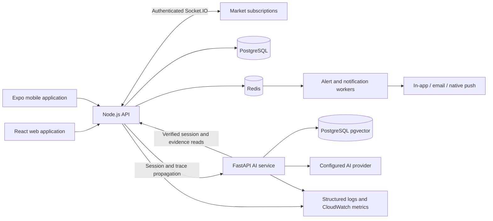
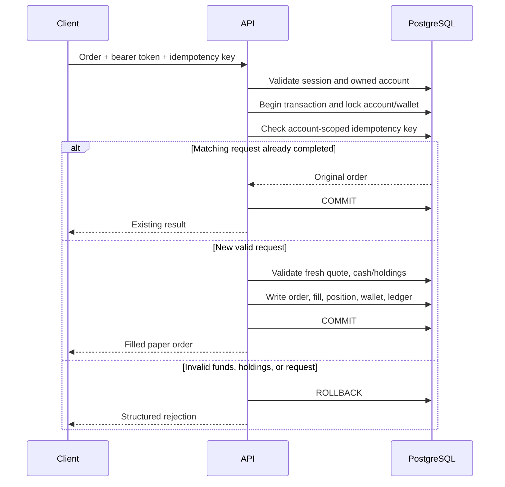
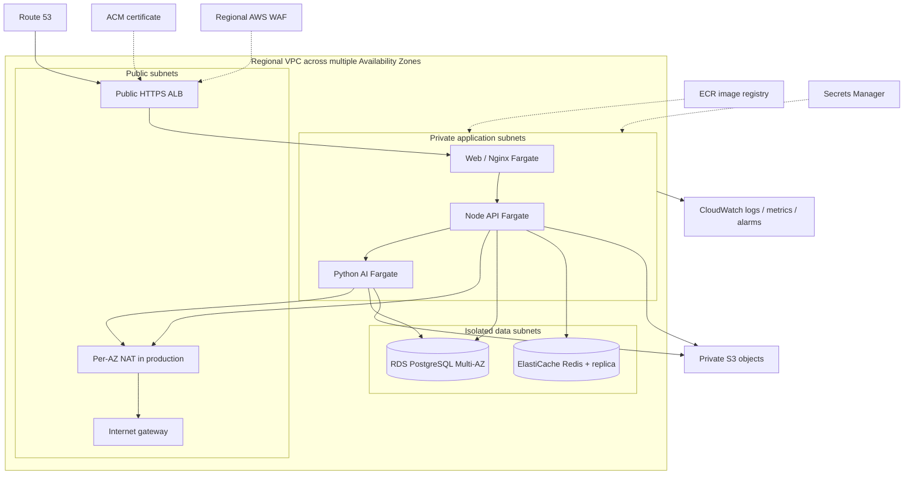
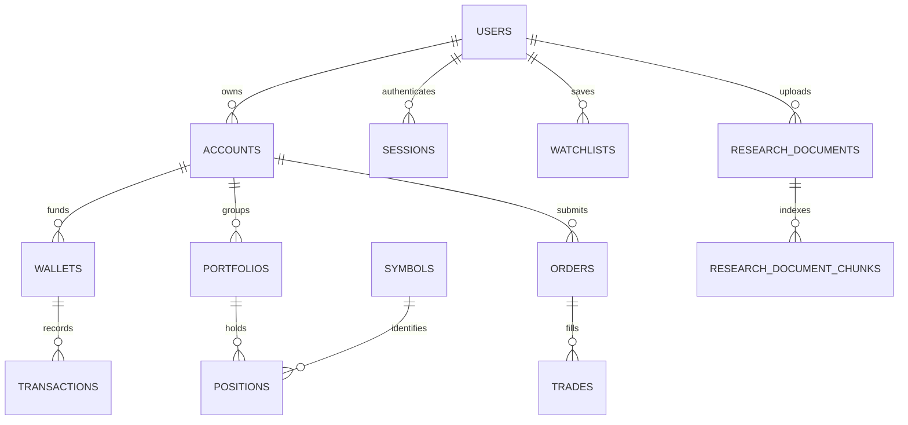

# Asteriq AI

### AI-Powered Global Trading & Investment Platform

An engineering case study in full-stack fintech applications, transactional paper
trading, AI-assisted research, and AWS delivery. Asteriq AI combines a React web
application, an Expo mobile client, a TypeScript API, and a Python research service
in one monorepo.

**Current scope:** educational paper trading with simulated market data. Global
market coverage is a product direction; live brokerage execution, real-money
funding, and automatic currency conversion are not implemented.

| Implemented                                                                               | Configured for deployment                                         | Planned or awaiting validation                                                                             |
| ----------------------------------------------------------------------------------------- | ----------------------------------------------------------------- | ---------------------------------------------------------------------------------------------------------- |
| API-backed trading, authentication, alerts, research, mobile flows, decimal ledger, tests | Docker, GitHub Actions, AWS Terraform, CloudWatch instrumentation | Live AWS deployment, complete browser recovery flows, expanded test runners, measured 10,000-user capacity |

## Project Overview

Asteriq AI explores how to build a trading-oriented product while keeping account
state consistent, research explainable, and deployments reviewable. The project
connects user-facing workflows to the operational details behind them: ownership
checks, concurrent orders, session rotation, worker retries, infrastructure boundaries,
and service-level monitoring.

The repository is organized around four applications:

- **Web:** React/TypeScript workspace for trading, charts, alerts, and cited research.
- **Mobile:** React Native/Expo client with device-local unlock and shared server sessions.
- **API:** Express/TypeScript service owning authentication, accounts, paper trades,
  portfolios, watchlists, and notifications.
- **AI service:** FastAPI service for technical analysis, sentiment, research generation,
  document retrieval, and optional experimental ML inference.

For interview discussion, the strongest engineering examples are transaction
integrity under concurrency, ownership across service boundaries, mobile refresh
races, evidence-grounded AI responses, immutable release promotion, and the
difference between implemented telemetry and measured production capacity.

## Problem Statement

Investment interfaces often combine prices, account balances, orders, alerts, and
research while hiding the systems that make those views trustworthy. A useful
learning platform needs to address several engineering problems together:

1. Prevent repeated or concurrent requests from overspending virtual cash or shares.
2. Keep web and mobile account data consistent and isolated between users.
3. Deliver market updates and notifications across multiple API instances.
4. Explain the evidence and limitations behind AI-generated research.
5. Make changes testable, deployable, observable, and reversible.

Asteriq AI provides a practical environment for these problems using synthetic
prices and paper funds. It also documents the work required before a production
financial application could rely on the design.

## Features

| Area              | Capability                                                                                      | Implementation boundary                                                              |
| ----------------- | ----------------------------------------------------------------------------------------------- | ------------------------------------------------------------------------------------ |
| Accounts          | Registration, verification, password login, refresh rotation, recovery APIs, session revocation | Web verification/reset pages remain incomplete                                       |
| Market data       | Instrument discovery, simulated quotes, stored history, sampled OHLCV, Socket.IO subscriptions  | No licensed exchange feed or guaranteed real-time market coverage                    |
| Paper trading     | Buy/sell execution, cash/holding checks, idempotency, transactional ledger writes               | Market orders fill immediately at an eligible server quote                           |
| Portfolio         | Holdings, average cost, realized/unrealized P/L, allocation, analytics API                      | No automatic FX conversion, tax calculation, or brokerage reconciliation             |
| Watchlists        | Owner-scoped saved lists and symbols                                                            | Trading workspace persistence is API-backed; standalone web view includes demo state |
| Alerts            | Price/percentage conditions, pause/cancel, Redis-stream processing, deduplicated notifications  | Email/push require provider configuration and device validation                      |
| AI research       | Structured reports, citations, evidence timestamps, limitations, portfolio context              | Generated content can be incomplete or incorrect                                     |
| Document research | Text/Markdown/PDF ingestion, embeddings, pgvector search, owner-scoped citations                | Bounded supported inputs; scanned PDFs require external OCR                          |
| Operations        | CI/CD, Terraform, logs, metrics, dashboards, alarms, SLO definitions                            | AWS provisioning and live operational verification remain separate steps             |

## Architecture



| Decision                          | Engineering purpose                                             | Trade-off                                                                 |
| --------------------------------- | --------------------------------------------------------------- | ------------------------------------------------------------------------- |
| Shared TypeScript contracts       | Keep client/API response types aligned                          | Shared packages must build before consumers                               |
| PostgreSQL as financial authority | Atomic account, holding, trade, and ledger updates              | Locking, pool budgets, and query performance require testing              |
| Redis for coordination            | Fanout, rate limits, session revocation markers, worker streams | Persistence and replay guarantees need explicit operational policy        |
| Separate Python service           | Isolate analysis/model dependencies and scaling                 | Adds network, authentication-callback, and failure-handling boundaries    |
| Digest-based deployments          | Promote the scanned image without rebuilding                    | Release manifests and artifact retention must remain available            |
| CloudWatch EMF                    | Publish application metrics through existing log streams        | Log volume, dimensions, and best-effort delivery affect cost and accuracy |

See the [detailed architecture assessment](.github/modernize/assessment/engines/facts/architecture-diagram.md).

## Technology Stack

| Layer         | Technologies                                                                                           |
| ------------- | ------------------------------------------------------------------------------------------------------ |
| Web           | React 19, TypeScript, Vite, Tailwind CSS, TanStack Query, lightweight-charts, Recharts                 |
| Mobile        | React Native, Expo SDK 53, React Navigation, SecureStore, local authentication, native SVG charts      |
| Backend       | Node.js 22, Express, TypeScript, Zod, jose, PostgreSQL client, Socket.IO                               |
| AI/ML         | Python 3.12, FastAPI, Pydantic, Pandas, NumPy, scikit-learn, LangChain, configured OpenAI provider     |
| Retrieval/NLP | pgvector, document splitting/PDF extraction, optional pinned local FinBERT                             |
| Data          | PostgreSQL, Redis, SQL migrations                                                                      |
| Delivery      | Docker, Docker Compose, Nginx, GitHub Actions, Trivy, ECR, Terraform                                   |
| AWS           | VPC, Route 53, ACM, WAF, ALB, ECS Fargate, RDS, ElastiCache, S3, Secrets Manager, CloudWatch           |
| Testing       | Existing Node test runner and pytest; Vitest/RTL, Jest/Supertest, Playwright strategy; k6 load scripts |

Dependency versions and lockfiles in each workspace are the source of truth.

## Web Application

The web application includes authentication, a trading workspace, interactive
financial charts, alerts, document management, and AI research with visible source
references. The trading workspace reads server quotes, balances, orders, trades,
and saved watchlists; submission results refresh account queries.

Reusable components handle loading, unavailable data, validation, confirmation,
and retry states. Research excerpts are rendered as text, and reports expose source
availability and educational limitations.

Some standalone dashboard, market, portfolio, watchlist, transaction, and settings
views still use demonstration data or UI scaffolding. Their displayed values should
not be treated as authoritative account state. The API-backed trading/research
workspaces and the remaining demo views are separate implementation milestones.

Source: [apps/web](apps/web).

## Mobile Application

The Expo client shares the API's REST and Socket.IO contracts. It includes
authentication, markets, trading, portfolio, watchlist, research, alerts, and
settings screens.

- Access tokens remain in memory; refresh credentials use SecureStore.
- PIN/biometric unlock protects the device-local session and does not replace
  server authentication.
- Background transitions lock the UI, stop subscriptions, and clear private caches.
- Refresh handling accounts for rotation, background locks, and late responses.
- Trade retries preserve the reviewed order and its idempotency key.
- Push enrollment is opt-in and requires a physical/native build and platform credentials.

Signed APK/IPA builds and app-store publication are not included as completed
deliverables. See [mobile setup and security boundaries](apps/mobile/README.md).

## AI/ML Features

| Capability                  | Approach                                                                        | Interpretation                                                              |
| --------------------------- | ------------------------------------------------------------------------------- | --------------------------------------------------------------------------- |
| Technical analysis          | SMA/EMA, RSI, MACD, Bollinger bands, historical return, volatility, drawdown    | Describes supplied historical candles                                       |
| Lexical sentiment           | Deterministic English financial lexicon                                         | Text polarity, not a probability of profit                                  |
| Financial NLP               | Optional local FinBERT with a pinned model revision                             | Requires dependencies and a warmed model cache                              |
| Research assistant          | LangChain structured generation from retrieved market/portfolio evidence        | Seven cited sections with source and data-quality metadata                  |
| Document RAG                | Bounded ingestion, embeddings, owner-scoped pgvector retrieval                  | Similarity ranking does not establish factual accuracy                      |
| Experimental classification | Logistic Regression, Random Forest, Gradient Boosting, chronological evaluation | Optional artifact; no default production model or demonstrated trading edge |

The ML pipeline uses chronological holdouts, purged label-horizon gaps, and
training-only cross-validation. Evaluation reports include class support and
baselines; synthetic test results are not evidence of real-market performance.

Identity/session credentials are excluded from LLM evidence, and implicit private
input tracing is disabled. Selected documents and portfolio evidence can be sent
to the configured provider; disclose that processing and review data policy.

Runbooks: [research assistant](apps/ai-service/RESEARCH_ASSISTANT.md),
[document RAG](apps/ai-service/RAG.md),
[technical analysis](apps/ai-service/TECHNICAL_ANALYSIS.md),
[news sentiment](apps/ai-service/NEWS_SENTIMENT.md),
[experimental ML pipeline](apps/ai-service/ML_PIPELINE.md).

## Trading Engine

The server determines the execution quote, validates ownership and currency,
checks cash or holdings, and performs all financial writes in one PostgreSQL
transaction. Amounts and quantities cross API boundaries as decimal strings.



Tests cover idempotent retries, conflicting key reuse, competing buys, oversells,
precision boundaries, and rejection rollback. Filled market orders cannot be
cancelled; cancellation applies to eligible open-order fixtures.

## Security

Implemented controls include bcrypt password hashing, short-lived signed access
JWTs, opaque hashed refresh tokens, transactional rotation/reuse detection,
HttpOnly production refresh cookies, strict request schemas, parameterized SQL,
owner-scoped queries, database-backed admin roles, and Redis-backed rate limits.

AWS configuration uses private application/data subnets, scoped task/execution
roles, encrypted managed data services, Secrets Manager, and GitHub OIDC.
Application secrets are not committed or exposed through public client variables.

The [security design review](docs/security-review.md) documents the baseline risks
and remediation examples. The [principal review](docs/principal-review.md) records
implemented session, proxy, recovery-link, financial-read and migration-isolation
fixes. Production approval still needs privileged MFA, verified database grants,
and the remaining hardening/telemetry gaps. A design review and passing
unit tests do not establish regulatory compliance or production security certification.

## DevOps

An alternative [Kubernetes/EKS deployment](k8s/README.md)
includes Kustomize manifests, ALB ingress, autoscaling, pod security, network
policies, managed database/cache integration and a migration-before-rollout script.

[Independent Helm charts](helm/README.md) package the frontend, API and AI service
with environment values, schema validation, configurable probes and autoscaling.
The [asteriq-platform umbrella chart](helm/asteriq-platform/README.md) installs
all three dependencies as one release with dev, staging and production profiles.
[Argo CD GitOps](gitops/README.md) adds reviewed digest promotion, environment
projects, automated development/staging reconciliation and controlled production sync.

The repository includes environment-specific Compose overrides, multi-stage API/web
images, non-root API/Python runtimes, health checks, persistent local volumes,
checksummed SQL migrations, and separate Terraform roots for dev/staging/production.

```text
apps/                 web, mobile, api, ai-service
packages/             shared types, UI, utilities, configuration
database/             numbered migrations and synthetic seeds
infrastructure/       Docker, IAM templates, Terraform modules/environments
.github/workflows/    PR, main, production, reusable quality, Terraform checks
scripts/              migrations and release/deployment helpers
tests/load/           k6 mixed workload and Socket.IO helper
docs/                 architecture, API, security, testing, operations runbooks
```

The mobile client is built through Expo/EAS configuration separately from the
three containerized web/API/AI services. Local Compose is a development/preview
environment; the AWS configuration is the multi-AZ deployment foundation.

## CI/CD

| Workflow              | Trigger                                | Behavior                                                                                                                           |
| --------------------- | -------------------------------------- | ---------------------------------------------------------------------------------------------------------------------------------- |
| Pull Request          | PR targeting main                      | Quality gates, Docker builds, Trivy image scans                                                                                    |
| Main                  | Push to main                           | Same gates; publish scanned images to ECR and assemble a release manifest                                                          |
| Production Deployment | Manual run ID promotion from main      | Verify release provenance/digests, rescan, migrate, roll out ECS, attempt restoration of prior task definitions on rollout failure |
| Terraform             | Infrastructure changes/manual dispatch | Formatting, provider validation, mocked production guardrail tests                                                                 |

Actions are pinned to commits. AWS publishing/deployment uses OIDC roles rather
than long-lived AWS access keys. Production environment reviewers and branch
restrictions must be configured in GitHub. Database changes require compatible
migrations; restoring application task definitions does not undo schema changes.

Setup: [CI/CD guide](docs/ci-cd.md).

## AWS Architecture

The implemented Terraform baseline keeps the web/Nginx container to match the
existing three-service release contract:



Terraform provisions networking, security groups, certificates/DNS, compute,
repositories, data stores, secret containers, and observability. State uses a
separate encrypted/versioned S3 bootstrap and environment-specific keys/locking.
Production guardrails enforce redundancy and log retention.

CloudFront/S3 frontend hosting and SES provisioning remain architecture extensions.
SES can supply the configured SMTP service. The existing AI authentication callback
needs its documented AWS URL/security-group configuration resolved before rollout.
No live AWS deployment or availability/cost benchmark is claimed.

Setup: [Terraform infrastructure](infrastructure/terraform/README.md).

## Database

PostgreSQL owns users, sessions, accounts, wallets, portfolios, positions, orders,
trades, the virtual-cash ledger, watchlists, alerts, notifications, and research.
pgvector supports owner-scoped document retrieval.



Schema constraints enforce relationships, nonnegative financial state, and
account-scoped idempotency. UPDATE/DELETE triggers protect ledger/audit rows;
database ownership and TRUNCATE privileges still require separate hardening.
Migrations use a lock and recorded checksums to reject modified applied files.
Restricted runtime identities and independent audit retention are production tasks.

References: [database design](docs/database-design.md),
[migrations](database/migrations), [synthetic seed](database/seeds/001_demo_data.sql).

## Screenshots

No screenshot assets are currently checked in. Capture these views from a running
build using synthetic accounts, with visible simulated-data labels and no credentials:

| View         | What to demonstrate                                            |
| ------------ | -------------------------------------------------------------- |
| Web trading  | Quote chart, order review, submitted fill, refreshed balances  |
| Web research | Structured response, citations, excerpt provenance, disclaimer |
| Alerts       | Saved condition and deduplicated triggered notification        |
| Mobile       | Market/portfolio views, trade review, device unlock            |
| CloudWatch   | Request/AI latency, resource pressure, SLO attainment          |

Screenshots should document implemented behavior, rather than imply that demo
values or unprovisioned dashboards came from a live production deployment.

## Getting Started

Requirements: Node.js 22+, npm 10+, Python 3.12 for host development, Docker
Desktop/Engine with Compose v2, and an Expo-compatible device/emulator for mobile.

From the repository root, the quickest path is Docker:

```sh
cp .env.docker.dev.example .env.docker.dev
docker compose --env-file .env.docker.dev -f docker-compose.yml -f docker-compose.dev.yml up --build
```

PowerShell also supports `Copy-Item .env.docker.dev.example .env.docker.dev`.
Only use the template's example credentials in disposable local development.

| Service                          | Local address                                              |
| -------------------------------- | ---------------------------------------------------------- |
| Web development                  | http://localhost:5173                                      |
| Built web preview (base Compose) | http://localhost:8080                                      |
| Node API                         | http://localhost:3000/api/v1                               |
| FastAPI OpenAPI UI               | http://localhost:8000/docs                                 |
| PostgreSQL / Redis               | localhost:5432 / localhost:6379, development override only |

The API entrypoint applies numbered migrations to a fresh database before startup.
Optionally load the synthetic seed into a disposable development database.
Register and verify an account using SMTP or the development-only token workflow
in [authentication.md](docs/authentication.md). The web verification/reset pages
are not complete; the corresponding server endpoints exist.

For host-based development, start only PostgreSQL/Redis containers, configure root
and web `.env` files, and run these commands in separate terminals:

```sh
cp .env.example .env
cp apps/web/.env.example apps/web/.env
docker compose --env-file .env.docker.dev -f docker-compose.yml -f docker-compose.dev.yml up -d postgres redis
npm ci
npm run build --workspace @asteriq/types
npm run db:migrate
npm run dev:api
npm run dev:web
```

Do not start host applications on ports already occupied by the full Docker stack.
The web predev script builds its shared UI/utilities. Start the Python service in
another terminal when using analysis/research endpoints:

Activate the virtual environment with the command for your shell before installing dependencies.

```sh
python -m venv .venv
# PowerShell: .\.venv\Scripts\Activate.ps1
# macOS/Linux: source .venv/bin/activate
python -m pip install -r apps/ai-service/requirements.txt -r apps/ai-service/requirements-assistant.txt -r apps/ai-service/requirements-rag.txt -r apps/ai-service/requirements-dev.txt
python -m uvicorn app.main:app --reload --app-dir apps/ai-service --host 127.0.0.1 --port 8000
```

Technical/lexical analysis can run without an external AI key. Research generation
and embeddings require the server-side provider configuration; FinBERT/model
inference requires its optional dependencies/cache/artifact.

Start mobile with `npm run dev:mobile` after setting its public API/socket URLs to
an address reachable from the emulator/device. Follow the [mobile runbook](apps/mobile/README.md).

## Docker Setup

| Mode                     | Compose files               | Purpose                                                  |
| ------------------------ | --------------------------- | -------------------------------------------------------- |
| Development              | Base + development override | Reloading sources, Vite, loopback dependency ports       |
| Built preview            | Base only                   | Built web/API/AI images and Nginx gateway                |
| Production configuration | Base + production override  | Required secrets, private backends, gateway behind HTTPS |

```sh
# Built local preview
docker compose --env-file .env.docker.dev -f docker-compose.yml up --build

# Production configuration: populate required values and provision HTTPS first
docker compose --env-file .env.docker.prod -f docker-compose.yml -f docker-compose.prod.yml config --quiet
docker compose --env-file .env.docker.prod -f docker-compose.yml -f docker-compose.prod.yml up --build -d
```

Copy `.env.docker.prod.example` before using the production commands. Compose
publishes the web gateway on loopback by default; it does not provision cloud
high availability or a public HTTPS certificate. Do not combine development and
production overrides. Review volumes/backups before changing or removing data.

Details: [Docker runbook](docs/docker.md).

## Environment Variables

| Variables                                                       | Purpose                                  | Boundary                                                      |
| --------------------------------------------------------------- | ---------------------------------------- | ------------------------------------------------------------- |
| `DATABASE_URL`, `RAG_DATABASE_URL`                              | API and AI database identities           | Server-only; use verified TLS and restricted production roles |
| `REDIS_URL`                                                     | Cache/coordination connection            | Server-only; AWS Redis requires TLS/authentication            |
| `JWT_ACCESS_SECRET`, `JWT_ISSUER`, `JWT_AUDIENCE`               | Access-token signing/validation          | Strong server secret; never client configuration              |
| `CORS_ORIGINS`, `AUTH_WEB_URL`                                  | Allowed browser origins and auth links   | Match actual HTTPS frontend                                   |
| `AI_SERVICE_URL`, `RESEARCH_BACKEND_URL`                        | Internal service/callback routing        | Network and authentication boundaries must be configured      |
| `SMTP_URL`, `AUTH_EMAIL_FROM`                                   | Verification/recovery/notification email | Server-only credentials; required in production API mode      |
| `OPENAI_API_KEY`, `OPENAI_RESEARCH_MODEL`                       | Research generation and embeddings       | Python service only                                           |
| `NEWS_SENTIMENT_*`, `ML_MODEL_PATH`, `ML_MODEL_SHA256`          | Optional NLP and trusted model artifact  | No untrusted model uploads                                    |
| `DEFAULT_CURRENCY`, `INITIAL_VIRTUAL_CAPITAL`                   | Paper-account defaults                   | Virtual funds only                                            |
| `ALERT_WORKERS_ENABLED`, `EXPO_ACCESS_TOKEN`                    | Workers and optional push delivery       | Server configuration; push token is secret                    |
| `OBSERVABILITY_ENABLED`, `ASTERIQ_ENVIRONMENT`                  | EMF telemetry and environment label      | Set by ECS task configuration                                 |
| `VITE_API_URL`, `EXPO_PUBLIC_API_URL`, `EXPO_PUBLIC_SOCKET_URL` | Client-reachable endpoints               | Public values embedded in bundles                             |
| `EXPO_PUBLIC_EAS_PROJECT_ID`                                    | Native push project identity             | Public identifier, not an access token                        |

Templates: [root](.env.example), [Docker development](.env.docker.dev.example),
[Docker production](.env.docker.prod.example), [web](apps/web/.env.example),
[mobile](apps/mobile/.env.example), [AI service](apps/ai-service/.env.example).
Never commit populated secret files, production state/plans, or load-test session
datasets. Development token output must remain disabled in production.

## API Documentation

The Node API uses `/api/v1` and structured envelopes:

```json
{
  "ok": true,
  "data": {},
  "requestId": "generated-request-id"
}
```

| Resource       | Example endpoint                                       |
| -------------- | ------------------------------------------------------ |
| Authentication | `POST /api/v1/auth/login`, `POST /api/v1/auth/refresh` |
| Market data    | `GET /api/v1/market/quotes/:symbol`                    |
| Paper orders   | `POST /api/v1/orders`                                  |
| Portfolio      | `GET /api/v1/portfolio/analytics`                      |
| Saved lists    | `GET /api/v1/watchlists`                               |
| Alerts         | `POST /api/v1/alerts`                                  |
| Research       | `POST /api/v1/ai/research/assistant`                   |
| Documents      | `POST /api/v1/ai/research/documents`                   |
| Health         | `GET /api/v1/health`, `GET /api/v1/ready`              |

Private resources require a bearer access token and server-side session checks.
Socket.IO uses `market:subscribe`, `market:unsubscribe`, and `market:quote` events
with symbol UUIDs. FastAPI publishes interactive OpenAPI documentation at `/docs`.

Contracts: [REST and Socket.IO](docs/api.md), [authentication](docs/authentication.md),
[Python service](apps/ai-service/README.md).

## Testing

Current automated checks include Node-based web/mobile/API tests, real PostgreSQL
and Redis integration fixtures when configured, pytest analysis/RAG tests,
Docker/migration configuration tests, and mocked Terraform guardrails.

```sh
npm run lint
npm run format:check
npm run typecheck
npm run build
npm test
npm run test:docker
```

For Python, install the base/assistant/RAG/dev dependencies listed above, then
run `python -m pytest tests -q` from `apps/ai-service`. Database suites need
dedicated test services and their documented test URLs; a skipped local integration
test is not evidence that the database behavior passed.

The [testing strategy](docs/testing-strategy.md) provides Vitest/React Testing
Library, Jest/Supertest, and Playwright configurations, fixture contracts, and
sample cases. Those new runners/adapters are not yet installed as the active suite.

The [k6 design](docs/load-testing.md) includes 10,000 logical users, authenticated
streams, portfolio reads, paper orders, and AI traffic. Scripts require prepared
identities, provider stubs, and an approved target. **No 10,000-user benchmark has
been run or demonstrated.**

## Monitoring

CloudWatch instrumentation covers HTTP request count/latency/4xx/5xx, socket
activity, committed trades, pool pressure, Redis health, AI gateway/provider failures,
and native ECS/RDS/ElastiCache CPU, memory, connections, and task counts.

Structured logs carry W3C trace IDs across API/AI boundaries. These are correlation
IDs; exported OpenTelemetry/X-Ray traces are an optional extension.
Terraform creates operations/SLO dashboards and multi-window burn alarms.

| Initial component objective | Target                                             |
| --------------------------- | -------------------------------------------------- |
| API availability            | 99.9% eligible requests                            |
| API latency                 | 99% successful core requests within 500 ms         |
| AI research availability    | 99% eligible research requests                     |
| AI research latency         | 95% successful research requests within 10 seconds |

Objectives are proposed operating targets, not achieved guarantees. Configure SNS
delivery, roll out instrumented task revisions, and verify live extraction/alarms.
Trade telemetry is best effort; the ledger remains the financial authority.

Runbook: [observability stack](docs/observability.md).

## Future Roadmap

- Resolve documented High security findings and production configuration gaps.
- Replace remaining demo-backed web views with owner-scoped API workflows.
- Complete browser email verification, recovery, and session-management journeys.
- Implement the proposed Vitest/Jest/Playwright fixture migration and required CI gates.
- Run staged capacity, contention, failure-recovery, and soak tests; publish measured results.
- Validate AWS deployment, paging, backup restore, secret rotation, and regional recovery.
- Evaluate CloudFront/S3 frontend delivery, SES API integration, and optional ADOT tracing.
- Add licensed market-data integrations with explicit freshness and provider rights.
- Extend currency handling and AI evaluations using suitable datasets and reviewed requirements.

Any future brokerage or real-money feature requires separate product, regulatory,
security, custody, and risk-control design. It is outside the current implementation.

## Disclaimer

Asteriq AI is an educational engineering project. Prices, balances, and order
executions are simulated. AI-generated research is not investment advice and can
contain errors; no profit, return, accuracy, or suitability guarantee is provided.

The repository does not implement a brokerage, custody, real-money deposits or
withdrawals, or live exchange order routing. Review implementation boundaries,
security findings, data-provider terms, and operational requirements before any
deployment or financial integration.
