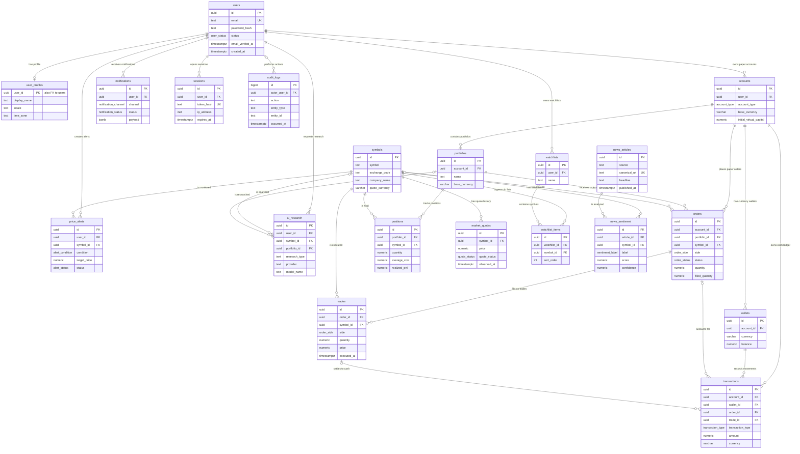

# Asteriq AI PostgreSQL Database Design

This design defines a PostgreSQL system of record for a paper-trading product. It includes 20 requested entities; PostgreSQL owns durable financial simulation state, while Redis is only an optional cache/coordination layer and virtual balances do not represent deposits or withdrawable funds.

## Entity Relationship Diagram

<!-- mermaid-checked: every attribute is `<type> <name> [<key>] ["<description>"]` with at most one of PK/FK/UK, no \n in descriptions, no {} in descriptions, every relationship label is double-quoted -->

## Table specifications

The migration at [001_initial_schema.sql](../database/migrations/001_initial_schema.sql) is authoritative for exact nullability, constraints, defaults, FK delete behavior, indexes, and enum definitions. All UUIDs are generated with PostgreSQL `pgcrypto`; amounts and prices use `NUMERIC`, never floating-point. Timestamps use `timestamptz` and are stored in UTC.
Authentication token storage is added in [002_authentication.sql](../database/migrations/002_authentication.sql); database-backed authorization roles are added in [003_api_rbac.sql](../database/migrations/003_api_rbac.sql).

| Table             | Columns and types                                                                                                                                                                                           | Primary key | Foreign keys                                                                                                                      | Indexes, uniqueness, and important constraints                                                                                                                       | Relationships                                                                                                                    |
| ----------------- | ----------------------------------------------------------------------------------------------------------------------------------------------------------------------------------------------------------- | ----------- | --------------------------------------------------------------------------------------------------------------------------------- | -------------------------------------------------------------------------------------------------------------------------------------------------------------------- | -------------------------------------------------------------------------------------------------------------------------------- |
| `users`           | `id uuid`, `email text`, `password_hash text`, `status user_status`, `email_verified_at timestamptz`, `created_at/updated_at/deleted_at timestamptz`                                                        | `id`        | None                                                                                                                              | Unique `lower(email)`; status/creation index; nonblank email; deleted status must align with deleted timestamp                                                       | One user to optional profile and many accounts, watchlists, alerts, notifications, research requests, sessions, and audit events |
| `user_profiles`   | `user_id uuid`, `display_name text`, `locale text`, `time_zone text`, timestamps                                                                                                                            | `user_id`   | `user_id -> users.id ON DELETE CASCADE`                                                                                           | Display name length check; PK is also the unique one-to-one user key                                                                                                 | One-to-one with user                                                                                                             |
| `accounts`        | `id uuid`, `user_id uuid`, `account_type account_type`, `name text`, `base_currency varchar(3)`, `initial_virtual_capital numeric(20,4)`, timestamps                                                        | `id`        | `user_id -> users.id ON DELETE RESTRICT`                                                                                          | Currency format; positive virtual seed capital; composite unique `(id,user_id)` supports ownership-safe FK                                                           | User owns paper account; account owns wallets, portfolios, orders, cash transactions                                             |
| `wallets`         | `id uuid`, `account_id uuid`, `currency varchar(3)`, `balance numeric(20,4)`, `updated_at timestamptz`                                                                                                      | `id`        | `account_id -> accounts.id ON DELETE RESTRICT`                                                                                    | Unique `(account_id,currency)`; unique `(account_id,id)` for account-consistent transaction FK; nonnegative projection balance                                       | One account has one wallet per currency; wallet has cash transactions                                                            |
| `symbols`         | `id uuid`, `symbol text`, `exchange_code text`, `company_name text`, `asset_type text`, `quote_currency varchar(3)`, `country_code varchar(2)`, `is_active boolean`, provider fields, timestamps            | `id`        | None                                                                                                                              | Unique `(exchange_code,symbol)`; active search index; provider-symbol index; currency/country formats                                                                | Referenced by quote history, watchlists, orders, trades, positions, alerts, sentiment, and research                              |
| `market_quotes`   | `id uuid`, `symbol_id uuid`, `price numeric(20,8)`, `currency varchar(3)`, `quote_status quote_status`, `source text`, `observed_at/received_at timestamptz`                                                | `id`        | `symbol_id -> symbols.id ON DELETE RESTRICT`                                                                                      | `(symbol_id,observed_at DESC)`; `received_at DESC`; positive price, currency format, source required                                                                 | Many observations per symbol; status differentiates real-time, delayed, simulated, and stale                                     |
| `watchlists`      | `id uuid`, `user_id uuid`, `name text`, timestamps                                                                                                                                                          | `id`        | `user_id -> users.id ON DELETE CASCADE`                                                                                           | Unique `(user_id,name)`; `(user_id,updated_at DESC)`; bounded nonblank name                                                                                          | User owns many lists; list contains items                                                                                        |
| `watchlist_items` | `id uuid`, `watchlist_id uuid`, `symbol_id uuid`, `sort_order integer`, `created_at timestamptz`                                                                                                            | `id`        | Watchlist cascades on delete; symbol restricts delete                                                                             | Unique `(watchlist_id,symbol_id)`; indexes by symbol and list/order; nonnegative sort order                                                                          | Join entity between watchlist and symbol                                                                                         |
| `orders`          | `id uuid`, `account_id/portfolio_id/symbol_id uuid`, `side order_side`, `status order_status`, `quantity/filled_quantity/average_fill_price numeric(20,8)`, idempotency/rejection fields, timestamps        | `id`        | `(account_id,portfolio_id) -> portfolios(account_id,id)`; `symbol_id -> symbols.id`                                               | Unique `(account_id,idempotency_key)`; `(id,account_id)` for transaction FK; account/time, portfolio/status/time, symbol/time indexes; fill-state consistency checks | Paper account and portfolio submit orders; one order may produce multiple trades                                                 |
| `trades`          | `id uuid`, `order_id/symbol_id uuid`, `side order_side`, `quantity/price numeric(20,8)`, `currency varchar(3)`, `executed_at timestamptz`, `execution_reference text`                                       | `id`        | Order and symbol restrict delete                                                                                                  | `(order_id,executed_at)`, `(symbol_id,executed_at DESC)`; unique order/execution reference; positive quantity/price                                                  | Each row is a simulated fill; partial fills are multiple trades for an order                                                     |
| `positions`       | `id uuid`, `portfolio_id/symbol_id uuid`, `quantity/average_cost numeric(20,8)`, `realized_pnl numeric(20,4)`, `updated_at timestamptz`                                                                     | `id`        | Portfolio and symbol restrict delete                                                                                              | Unique `(portfolio_id,symbol_id)`; symbol and nonzero portfolio indexes; nonnegative quantity/cost                                                                   | One projection row per portfolio-symbol pair                                                                                     |
| `portfolios`      | `id uuid`, `account_id uuid`, `name text`, `base_currency varchar(3)`, timestamps                                                                                                                           | `id`        | `account_id -> accounts.id ON DELETE RESTRICT`                                                                                    | Unique `(account_id,name)` and `(account_id,id)`; account index; currency/name checks                                                                                | Account owns portfolios; portfolio is associated with orders and positions                                                       |
| `transactions`    | `id uuid`, `account_id/wallet_id/order_id/trade_id uuid`, `transaction_type transaction_type`, `amount numeric(20,4)`, `currency varchar(3)`, `idempotency_key text`, description, `created_at timestamptz` | `id`        | Composite `(account_id,wallet_id) -> wallets(account_id,id)`; `(order_id,account_id) -> orders(id,account_id)`; optional trade FK | Unique `(account_id,idempotency_key)`; indexes by account/time, wallet/time, optional order/trade; amount sign by type                                               | Append-only cash ledger; order and trade references explain movements                                                            |
| `price_alerts`    | `id uuid`, `user_id/symbol_id uuid`, `condition alert_condition`, `target_price numeric(20,8)`, currency, `status alert_status`, trigger price/time, timestamps                                             | `id`        | User cascades; symbol restricts delete                                                                                            | Partial active symbol/target index; user/time index; trigger state/fields consistency; positive prices                                                               | User creates many alerts for symbols                                                                                             |
| `notifications`   | `id uuid`, `user_id uuid`, channel/status enums, `notification_type/title/body text`, `payload jsonb`, dedup key, delivery/read times, `created_at`                                                         | `id`        | `user_id -> users.id ON DELETE CASCADE`                                                                                           | Unique `(user_id,deduplication_key)`; user/time, pending partial, payload GIN indexes                                                                                | User receives in-app, email, or push notification records                                                                        |
| `ai_research`     | `id/user_id/symbol_id/portfolio_id uuid`, research type, question/response/provider/model/prompt version text, `source_references jsonb`, data/generation/retention times                                   | `id`        | User cascades; optional symbol/portfolio set null                                                                                 | User/time, optional symbol/time, retention partial indexes; nonblank and retention checks                                                                            | User owns research output; it may reference symbol and/or portfolio                                                              |
| `news_articles`   | `id uuid`, source/source ID, canonical URL, headline/summary/hash, published/ingested times, language, metadata JSONB                                                                                       | `id`        | None                                                                                                                              | Unique canonical URL; unique `(source,source_article_id)`; publication/source indexes; required headline/source                                                      | Article has many model-versioned sentiment results                                                                               |
| `news_sentiment`  | `id/article_id/symbol_id uuid`, model/version, `label sentiment_label`, score/confidence numeric, `analyzed_at timestamptz`                                                                                 | `id`        | Article cascades; optional symbol set null                                                                                        | Unique `(article_id,symbol_id,model_name,model_version)`; symbol/time and label/time; bounded score/confidence                                                       | Sentiment is a versioned analysis of an article, optionally for a symbol                                                         |
| `sessions`        | `id/user_id uuid`, `token_hash text`, device label, `ip_address inet`, user agent, created/last-seen/expiry/revocation times                                                                                | `id`        | `user_id -> users.id ON DELETE CASCADE`                                                                                           | Unique token hash; active-user/expiry partial index; expiry index; expiry-after-creation check                                                                       | User has multiple sessions; only token hashes are stored                                                                         |
| `audit_logs`      | `id bigint identity`, optional `actor_user_id uuid`, action/entity/outcome/request text, `ip_address inet`, `metadata jsonb`, `occurred_at timestamptz`                                                     | `id`        | Optional actor references user with delete restricted to preserve immutable audit history                                         | Actor/time, entity/time, request partial, metadata GIN indexes; required action/entity/outcome                                                                       | Optional user actor produces many immutable audit records                                                                        |

### Enumerated values

- `order_side`: `BUY`, `SELL`.
- `order_status`: `PENDING`, `FILLED`, `PARTIALLY_FILLED`, `CANCELLED`, `REJECTED`.
- `account_type`: `PAPER` only.
- `quote_status`: `REALTIME`, `DELAYED`, `SIMULATED`, `STALE`.
- `transaction_type`: `VIRTUAL_FUNDING`, `BUY`, `SELL`, `FEE`, `ADJUSTMENT`.

Order rows encode side separately from status. A partially filled order that is later cancelled retains `CANCELLED` status and its nonzero `filled_quantity`; its actual fills remain independently represented by `trades`.

## PostgreSQL SQL schema

The complete executable DDL is [001_initial_schema.sql](../database/migrations/001_initial_schema.sql). It defines all 20 requested tables, their primary and foreign keys, supporting indexes, enum types, constraints, update-time triggers, and comments. Keeping DDL in a versioned migration rather than duplicating it inline here makes the migration the single source of truth.

Notable integrity choices:

- Composite foreign keys ensure an order's portfolio belongs to its account, and a transaction's wallet/order belongs to its account.
- Order idempotency is enforced durably by a unique account/key constraint; Redis must not be the only duplicate protection.
- Transaction amounts are signed: virtual funding and sell proceeds are positive, buy debits and fees negative. Corrections use compensating `ADJUSTMENT` rows.
- Database triggers reject updates and deletes to `transactions` and `audit_logs`; append a compensating ledger entry rather than rewriting history. User erasure therefore requires a documented retention/pseudonymization workflow, not a direct cascade delete of financial records.
- `wallets.balance` and `positions` are projections for reads; ledger transactions and trade fills remain the audit evidence.
- The schema is paper-only. It has no deposits, withdrawals, payment instruments, real brokerage identifiers, or real order routing.

## Migration strategy

1. Apply [001_initial_schema.sql](../database/migrations/001_initial_schema.sql) once to an empty PostgreSQL database using a migration runner that tracks applied versions and serializes migration execution. The API currently uses `pg` and does not automatically run migrations.
2. Run migrations in CI against the same supported PostgreSQL major version as production. Validate constraints, triggers, query plans, and seed data on a disposable database.
3. Treat applied migrations as immutable. Add a new monotonically numbered migration for every later schema change.
4. Use expand-and-contract for rolling deployments: add nullable/compatible structures, deploy dual-compatible application code, backfill in bounded batches, switch reads/writes, and remove obsolete columns in a later release.
5. Avoid table rewrites and long blocking locks during peak hours. Use concurrent index creation where supported and manage such migrations outside a transaction when PostgreSQL requires it.
6. Back up before production changes; test point-in-time restore and recovery procedures. Prefer forward-fix for financial data; never rollback by deleting ledger history.
7. Separate schema migration from demo/test seeding. The sample seed is not a production default and its demo password is disabled.

Operational migration notes and CLI invocation are in [database/migrations/README.md](../database/migrations/README.md).

## Indexing strategy

- Add indexes for FK columns used in joins and deletes; PostgreSQL does not automatically index the referencing side of every foreign key.
- Lead composite indexes with equality-filter columns, followed by sort/time columns: account plus submitted time, symbol plus quote time, user plus notification time.
- Use partial indexes for sparse active/pending/nonzero/optional states; keep predicates aligned with query filters.
- Use a unique lower-case email index instead of requiring the `citext` extension; normalize email consistently in the service as well.
- Use GIN only on JSONB fields that are actually queried (`notifications.payload`, `audit_logs.metadata`). Avoid indexing arbitrary JSON by default.
- Keep order uniqueness, foreign keys, and check constraints as correctness controls; do not replace them with application-only validation.
- Review `EXPLAIN (ANALYZE, BUFFERS)` on representative workloads and use `pg_stat_statements` in monitored environments. Revisit indexes as write volume grows because each index increases write and storage costs.
- Partition high-volume `market_quotes` and potentially `audit_logs` by time only after measuring volume, retention, and query patterns. Introduce partitioning via a planned migration; do not partition prematurely.
- Consider full-text/trigram search for symbols/news only when search volume and product requirements justify the extension and index cost.

## Example seed data

Runnable synthetic seed records are in [001_demo_data.sql](../database/seeds/001_demo_data.sql). They create one demo user, a paper account with **100,000 USD virtual capital**, a matching virtual wallet and funding ledger entry, one portfolio, two synthetic symbols and prices, a watchlist and alert, plus a simulated filled buy with its trade, cash-ledger entry, and position. Synthetic notification, news, sentiment, AI-research, and audit rows exercise the remaining data domains. No real market provider or real-money instrument is implied.

The demo password hash is deliberately invalid. Before exposing any environment publicly, remove demo identities and ensure no seed credentials can be used to authenticate.

## Ownership and access boundaries

| Service/module    | Tables owned                                              | Access pattern                                                                             |
| ----------------- | --------------------------------------------------------- | ------------------------------------------------------------------------------------------ |
| Identity          | `users`, `user_profiles`, `sessions`                      | Owns credential/session writes; other modules consume authenticated user identity          |
| Paper trading     | `accounts`, `wallets`, `orders`, `trades`, `transactions` | Owns account funding initialization, order/fill and append-only virtual cash ledger writes |
| Portfolio         | `portfolios`, `positions`                                 | Owns derived holdings/projections; rebuilds from trades and ledger                         |
| Market data       | `symbols`, `market_quotes`                                | Owns instrument catalog and timestamped quote ingestion                                    |
| User preferences  | `watchlists`, `watchlist_items`, `price_alerts`           | Owns user-scoped discovery preferences and alert conditions                                |
| Messaging         | `notifications`                                           | Owns delivery state, deduplication, and read state                                         |
| Research and news | `ai_research`, `news_articles`, `news_sentiment`          | Owns model outputs, source provenance, article metadata, and versioned sentiment           |
| Platform security | `audit_logs`                                              | Append-only security/domain audit writes with restricted read access                       |

The starter implementation may use one PostgreSQL database with logical table ownership and a single `pg` pool. Do not grant independent microservices unrestricted cross-domain writes. Enforce domain boundaries in the service layer and introduce separate database roles/schemas or databases as service ownership matures. Cross-domain reads should use documented read interfaces or rebuildable projections; order execution must use a consistency-safe transactional path, not a lagging read replica.

## Caching and financial consistency

Redis may cache current quotes, instrument metadata, rate counters, and short-lived projections. Quote cache entries must include provider/source and quote status, use a freshness-based TTL, and never masquerade as current after expiry. Session caching must respect revocation semantics. Financial idempotency has a PostgreSQL unique constraint, and the wallet balance cache/projection is reconciled to transactions. Redis loss must not lose or alter trades, orders, balances, or audit evidence.

## Data classification and sensitivity

| Entity                                                                                       | Sensitive fields                           | Classification                           | Controls in schema/design                                                                                                                           |
| -------------------------------------------------------------------------------------------- | ------------------------------------------ | ---------------------------------------- | --------------------------------------------------------------------------------------------------------------------------------------------------- |
| `users`                                                                                      | Email, password hash                       | PII, credential material                 | Password hash only; restrict access, TLS and encrypted storage/backups required operationally; no field-level encryption is implemented by this DDL |
| `user_profiles`                                                                              | Display name, locale, time zone            | PII/preferences                          | User-keyed access; no field-level encryption or masking implemented                                                                                 |
| `sessions`                                                                                   | Token hash, IP address, user agent         | Security-sensitive, personal data        | Store token hash only; restrict access and retention; no field-level encryption implemented                                                         |
| `audit_logs`                                                                                 | Actor ID, IP, request ID, metadata         | Security-sensitive, potentially personal | Restrict readers/writers, prohibit secrets in metadata, retain under policy; no field-level encryption implemented                                  |
| `ai_research`                                                                                | User question and generated response       | User content, potentially sensitive      | User ownership FK and retention timestamp; avoid unnecessary PII in prompts; no field-level encryption implemented                                  |
| `accounts`, `wallets`, `orders`, `trades`, `positions`, `transactions`, `portfolios`         | Simulated financial activity               | Sensitive user financial simulation data | Ownership-aware relations and append-only ledger policy; not PCI and not real brokerage account data                                                |
| `news_articles`, `news_sentiment`                                                            | Licensed content and model output          | Provider-licensed data                   | Source provenance and provider/version fields; enforce provider retention/redistribution terms outside the schema                                   |
| `symbols`, `market_quotes`, `watchlists`, `watchlist_items`, `price_alerts`, `notifications` | Market preferences, alert and message data | User activity and product data           | User ownership FKs for private records; authorization and retention enforced by application                                                         |

No PHI or PCI cardholder data is required or modeled. Encryption at rest, transport encryption, KMS key policies, backups, data masking, field-level controls, retention enforcement, and audit-reader authorization must be configured and tested operationally; they are not automatically provided by table definitions.
