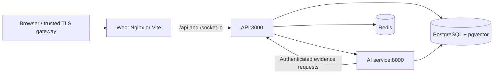

# Docker deployment

The platform has five services: **web**, **api**, **ai-service**, **postgres**, and **redis**. Each has a health check, restart policy, init process, and bounded container logs. Node.js and web Dockerfiles have development and runtime targets; the Python image has a reload target and a runtime target. Production Node.js dependencies are pruned; API and Python runtime processes run as non-root users.

## Development

From the repository root:

```powershell
Copy-Item .env.docker.dev.example .env.docker.dev
docker compose --env-file .env.docker.dev -f docker-compose.yml -f docker-compose.dev.yml up --build
```

Open **http://localhost:5173**. The development web service also remains available at **http://localhost:8080**. The API is at `http://localhost:3000/api/v1`, FastAPI docs at `http://localhost:8000/docs`, PostgreSQL at localhost:5432, and Redis at localhost:6379. All development port bindings use loopback. Override `POSTGRES_PORT`, `REDIS_PORT`, `API_PORT`, or `AI_SERVICE_PORT` in the development env file if a host port is in use.

Source directories are mounted read-only into containers; the host editor remains responsible for changes. Node.js uses `tsx watch`, shared packages use TypeScript watch builds, Vite provides HMR, and Python uses Uvicorn reload. Generated files and Linux dependencies stay inside their containers, so Windows/macOS `node_modules` and native binaries are never mounted over Linux dependencies. `DEV_POLLING=true` enables polling where Docker Desktop file events are unreliable. Dependency manifests or Dockerfiles changing requires rebuilding the affected image; SQL additions apply when the API restarts.

The local env template uses development-only credentials and enables `DEV_AUTH_TOKEN_OUTPUT` so authentication flows can be tested without an SMTP server. Disable this output when using actual SMTP. Production always disables it. Set `OPENAI_API_KEY` in the server env file to enable live research; a blank key does not stop local technical analysis or the rest of the platform, but research generation reports that it is unconfigured.

For a static local preview without source mounts:

```powershell
docker compose --env-file .env.docker.dev up --build
```

This serves the built web application at http://localhost:8080. Backend/database ports are internal in this configuration. It uses development API settings and is not the production configuration.

## Production

```powershell
Copy-Item .env.docker.prod.example .env.docker.prod
# Fill the required values, including SMTP, OpenAI, and the public HTTPS URL.
docker compose --env-file .env.docker.prod -f docker-compose.yml -f docker-compose.prod.yml config --quiet
docker compose --env-file .env.docker.prod -f docker-compose.yml -f docker-compose.prod.yml up -d --build --wait
```

Use separate randomly generated credentials for PostgreSQL, Redis, and JWT signing; the JWT secret must be at least 32 characters. For example, generate each value locally with `node -e "console.log(require('node:crypto').randomBytes(32).toString('hex'))"`. Hex passwords avoid connection-URL escaping; if using other characters, URL-encode the password component in `DATABASE_URL` and `REDIS_URL`. Ensure both URLs use internal `postgres` and `redis` hostnames and match the configured server credentials. The template expands the password variables into the connection URLs.

Compose refuses empty required production credentials, SMTP settings, or OpenAI credentials. The API's existing configuration validation also checks signing-secret length and email settings at startup. `SITE_URL` must be the public HTTPS origin, for example `https://research.example.com`; it sets CORS and authentication links. Keep populated env files out of source control. Avoid displaying `docker compose config` output containing secrets; `config --quiet` validates without printing the resolved environment.

Only the web gateway's port is published, on `127.0.0.1:8080` by default. Place a trusted TLS reverse proxy or load balancer in front of it, forward REST and WebSocket traffic, and pass a sanitized `X-Forwarded-Proto` header. Production authentication uses secure cookies, so serve the public site over HTTPS. Override `WEB_BIND` only when deliberately publishing the gateway on another interface. This configuration is a single-host Compose deployment; it does not provision TLS certificates or database/Redis high availability.

Production uses built images, has no code bind mounts, sets production application modes, disables development token output, requires Redis authentication, and adds `no-new-privileges` to application containers. Use the base and production files together, **without the development override**. The production project is `asteriq-ai-prod`, so its networks and volumes are separate from the default development project. Image tags follow selected major/runtime releases; pin registry digests in your deployment process for reproducible image promotion.

## Networking and web routing



The `data` network is internal and connects PostgreSQL, Redis, API, and AI service. PostgreSQL and Redis attach only to this network. The `application` bridge connects web, API, and AI service and permits the server-side egress needed for OpenAI, SMTP, and push providers. Production publishes no API, AI, PostgreSQL, or Redis host ports.

The browser calls relative `/api/v1` URLs. Nginx proxies REST and Socket.IO to the API; Vite uses the same proxy routes in development. No Docker service hostname or server secret is embedded in the browser bundle. Nginx supports WebSocket upgrade, re-resolves the API through Docker DNS, permits 10 MB request bodies, and allows 190 seconds for RAG ingestion/generation calls. The gateway `/health` endpoint checks Nginx; the API readiness probe checks PostgreSQL and Redis; the AI readiness probe checks the running local FastAPI service, not OpenAI account availability or optional model readiness.

## Startup and schema migrations

Startup is acyclic: PostgreSQL and Redis become healthy; AI waits for PostgreSQL; API waits for PostgreSQL, Redis, and AI; web waits for API readiness. [Docker's startup-order documentation](https://docs.docker.com/compose/how-tos/startup-order) explains health-gated dependencies. Health gates apply at startup, not as continuous dependency supervision. `unless-stopped` restarts exited containers; an unhealthy process that never exits still needs operational attention.

The API entrypoint runs `scripts/migrate.mjs` before starting the server or alert workers. The runner:

- Holds a database advisory lock so concurrent API starts cannot apply the schema twice.
- Reads numbered SQL files and records normalized-content checksums in `schema_migrations`.
- Commits each migration and its history row together, or rolls both back.
- Refuses edited/missing applied migrations and refuses to guess the version of an existing untracked schema.

Fresh volumes apply migrations 001–008 automatically, including pgvector RAG tables and the alert outbox. Synthetic instrument migration 004 is included; the separate demo-account seed is not run. The PostgreSQL image includes the vector extension. The database role running migrations needs extension/schema permissions; operators who use a restricted runtime role can perform schema changes separately and set `RUN_MIGRATIONS=false` on API services afterward.

For an **existing untracked database**, first verify exactly which numbered migrations are already installed and take your normal backup. If it is known to contain migrations through 006, baseline those versions explicitly and apply the remaining files:

```powershell
docker compose --env-file .env.docker.prod -f docker-compose.yml -f docker-compose.prod.yml run --rm --no-deps --entrypoint node api /workspace/scripts/migrate.mjs --baseline=006
```

Use the actual verified version; do not copy `006` blindly. The command records existing versions without replaying them, then applies later migrations. For a tracked database, run the same command without `--baseline` for a manual upgrade. An API restart automatically applies newly added migrations unless `RUN_MIGRATIONS=false`. Do not edit SQL files already applied to an environment.

## Persistent storage and optional models

| Volume          | Container path             | Contents                                                                               |
| --------------- | -------------------------- | -------------------------------------------------------------------------------------- |
| `postgres-data` | `/var/lib/postgresql/data` | Users, portfolios, alerts, notification history/outbox, RAG vectors, migration history |
| `redis-data`    | `/data`                    | AOF state, alert streams, caches, sessions, rate-limit data                            |
| `ai-artifacts`  | `/app/artifacts`           | Local financial NLP cache and trusted model artifacts                                  |

Normal `docker compose down` preserves named volumes. Do not add `--volumes` unless intentionally discarding that project's data. Back up persistent data independently; a volume is not a backup. Keep PostgreSQL major-version upgrades separate from application updates; the image and volume layout currently remain PostgreSQL 16. Changing `POSTGRES_PASSWORD` on an existing volume does not rotate the stored database password; coordinate the database role change with the application URLs.

Redis uses AOF, `appendfsync everysec`, and `noeviction`, matching the alert stream's persistence needs. The unsynced interval remains a possible loss window; stronger recovery objectives require adjusted persistence/replication and upstream replay. No blind stream trimming is configured.

FinBERT dependencies and model weights are optional and large. To enable local financial NLP:

1. Set `INSTALL_NEWS_NLP=true` in the selected env file and rebuild the AI image.
2. Warm the named model volume:

   ```powershell
   docker compose --env-file .env.docker.dev -f docker-compose.yml -f docker-compose.dev.yml run --rm --no-deps ai-service python scripts/warm_news_model.py --download
   ```

3. Start/recreate the AI service. `NEWS_SENTIMENT_LOCAL_FILES_ONLY=true` keeps inference local to the pinned cached model. `NEWS_SENTIMENT_LOCAL_FILES_ONLY=false` allows lazy download instead.

The `.dockerignore` excludes local virtual environments, `node_modules`, secrets, generated assets, test runtime files, and existing model caches. Model caches persist through the volume, rather than bloating the build context or being copied from a host-specific environment.

## Verification and operations

```powershell
npm run test:docker
docker compose --env-file .env.docker.dev -f docker-compose.yml -f docker-compose.dev.yml config --quiet
docker compose --env-file .env.docker.prod -f docker-compose.yml -f docker-compose.prod.yml config --quiet
docker compose --env-file .env.docker.prod -f docker-compose.yml -f docker-compose.prod.yml ps
docker compose --env-file .env.docker.prod -f docker-compose.yml -f docker-compose.prod.yml logs --tail 100 api ai-service
```

The Docker tests exercise resolved base/development/production configurations, dependency ordering, missing-secret rejection, network/port isolation, and migration lock/checksum/rollback behavior. They use fake credentials and do not require a Docker daemon. Image builds and container health checks require a running Docker Engine/Desktop; validate them with `up --build --wait` on your deployment architecture. Optional model readiness and live email/OpenAI/push calls require their separate credentials and caches.

See [Docker's production guide](https://docs.docker.com/compose/how-tos/production/) for the base-plus-production-override deployment pattern.
