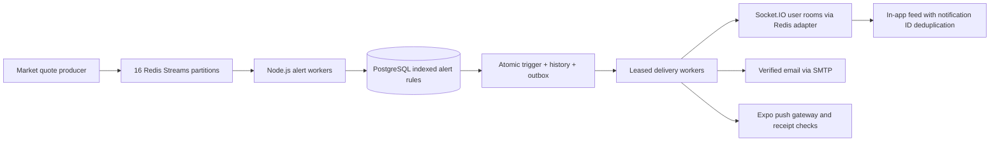

# Price alerts

Price alerts are one-shot rules. AAPL above 250 and TSLA below 300 use strict comparisons; equality does not trigger. `CHANGE_PERCENT` measures **absolute percentage change from the previous close**, in either direction, with an exact decimal comparison. A 5% rule triggers at more than +5% or less than -5%, not at exactly 5%. It is not measured from the alert creation price. Quotes marked `STALE` do not trigger alerts. Simulated and delayed prices are explicitly labeled in notification content.

## Architecture



Alert creation, status changes, and history use the existing authenticated REST API. The API derives the owner from the session; clients cannot supply another user's identity. Currency must match the registered instrument. Paused alerts do not trigger; resuming updates the activation timestamp so queued observations from before the resume cannot trigger. `TRIGGERED` and `CANCELLED` are terminal. Create a new alert to monitor another occurrence.

The market producer writes every quote to a stable symbol-hashed Redis partition, independently of chart subscribers and sampled historical persistence. Workers use one consumer group per stream and reclaim abandoned pending messages. [Redis Streams](https://redis.io/docs/latest/develop/data-types/streams/) provides consumer-group delivery and pending-entry recovery. Each Redis command targets a single stream key, with a partition hash tag for a future Redis Cluster deployment; the current client configuration connects to standalone Redis.

The evaluator selects eligible indexed thresholds in batches of 500, locks their rows, marks them triggered, inserts notification history, and creates delivery jobs in the **same database transaction**. A unique `(user_id, deduplication_key)` constraint prevents a second history record for the same alert/channel. A unique `(notification_id, target_key)` constraint prevents duplicate delivery jobs, including per-device push jobs. Concurrent evaluations recheck `ACTIVE` status under row locks. Match evaluation deliberately does not skip locked alert rows: a competing transaction may roll back, so skipping it and acknowledging the quote could lose a match.

The quote remains pending until all matching batches have committed. A single Redis Lua operation acknowledges and deletes it afterward. Crashes before acknowledgment replay safely through database state and unique constraints. There is exactly one consumer group on these quote streams by contract; adding another group requires changing the deletion policy. Malformed events are moved to a metadata-only `:invalid` stream for inspection and acknowledged so they do not block processing.

Delivery workers use short database leases and [`FOR UPDATE SKIP LOCKED`](https://www.postgresql.org/docs/current/sql-select.html) to claim disjoint jobs. Lease tokens prevent an expired worker from overwriting a replacement worker's result. Five jobs execute concurrently per worker. Failures use bounded exponential retry, with a maximum of eight delivery/receipt attempts before terminal failure. Notification history survives disconnected clients; in-app users retrieve it through REST on reconnect. Socket events carry a stable notification ID and both web and mobile clients deduplicate replayed events. Socket sessions are checked periodically and revoked sessions disconnect.

## Delivery guarantees

The database guarantees one logical history record and delivery job per alert/channel/target. Redis and delivery processing are at least once. Socket replay is deduplicated in the client. Email uses a stable Message-ID; push carries the stable notification ID and stores provider tickets before checking receipts. Accepted push tickets are not reported as completed delivery; missing receipts are polled again. Invalid device registrations are removed, and device eligibility is checked again immediately before sending. Push messages contain a generic update and a notification ID, rather than prices on a lock screen.

**SMTP and Expo do not provide an application idempotency guarantee here.** A provider may accept a send immediately before a worker crashes or before its database completion is committed. Retrying in that window can produce a repeated external email or push message. A stable SMTP Message-ID does not guarantee mail-server deduplication. If strict external exactly-once behavior is required, use a delivery provider with a durable idempotency-key API or explicitly choose a no-retry policy for ambiguous sends. This implementation favors eventual delivery while keeping logical records unique.

## Setup

Apply `database/migrations/008_price_alert_engine.sql` after existing migrations and before running the new workers. It adds percentage rules, channel preferences, matching indexes, and the delivery outbox. This migration does not alter or depend on RAG vectors. Do not apply it to a shared environment without the normal deployment migration process.

The API starts alert and delivery workers by default. For separate worker processes:

```powershell
# API environment
$env:ALERT_WORKERS_ENABLED = 'false'
npm run dev:api

# Separate terminal or deployment service
$env:ALERT_PARTITIONS = '0,1,2,3'
npm run worker:alerts --workspace @asteriq/api
```

Deploy complementary partition lists to distribute load, or let replicas consume all 16 partitions through the same group. Delivery jobs are shared through PostgreSQL, so any worker replica can claim them. Changing the partition count requires a controlled stream migration; the hashing scheme has a fixed count of 16.

- `DATABASE_URL` and `REDIS_URL`: existing service connections.
- `SMTP_URL` and `AUTH_EMAIL_FROM`: existing server-only email configuration. Email requires an active account with a verified address. SMTP transport timeouts are bounded.
- `EXPO_ACCESS_TOKEN`: optional server-only Expo push gateway token. Mobile devices enroll through the existing `/notifications/devices` API.
- `ALERT_WORKERS_ENABLED`: default `true`; set `false` on API replicas when scaling workers independently.

Docker Compose configures Redis AOF persistence, a data volume, and `noeviction`. The chosen `appendfsync everysec` policy can lose up to the unsynced interval on a server failure; select stronger persistence/replication and upstream quote replay if your recovery objectives require it. Do not apply a blind `MAXLEN` trim to these business streams: pending or unread quotes must not be discarded. Monitor pending age, stream lag, Redis memory, expired leases, job attempts, failed deliveries, provider rate limits, and PostgreSQL pool saturation. Review and expire invalid-event metadata under a separate operational retention policy. Keep financial notification history under your application's retention policy.

This is a scalable worker architecture, not a measured throughput guarantee. Benchmark real symbol/alert distributions and tune partitions, worker replicas, database pool limits, and provider quotas before production. In-app, email, and push currently share a bounded worker pool; dedicated channel-specific deployments and rate controls are a next step for very large delivery volumes. Redis unavailability rejects quote publication rather than silently claiming it was monitored; production quote adapters must retain/replay upstream observations after failures.

## API examples

Use a registered instrument UUID as `symbolId`, and an authenticated bearer token. In-app history is always included; optional channels are `EMAIL` and `PUSH`.

```json
{
  "symbolId": "66666666-6666-4666-8666-666666666661",
  "condition": "ABOVE",
  "targetPrice": "250",
  "currency": "USD",
  "channels": ["IN_APP", "EMAIL"]
}
```

```json
{
  "symbolId": "66666666-6666-4666-8666-666666666663",
  "condition": "BELOW",
  "targetPrice": "300",
  "currency": "USD",
  "channels": ["IN_APP", "PUSH"]
}
```

```json
{
  "symbolId": "66666666-6666-4666-8666-666666666662",
  "condition": "CHANGE_PERCENT",
  "targetChangePercent": "5",
  "currency": "USD",
  "channels": ["IN_APP", "EMAIL", "PUSH"]
}
```

| Method | Endpoint after `/api/v1`            | Purpose                                        |
| ------ | ----------------------------------- | ---------------------------------------------- |
| POST   | `/alerts`                           | Store an alert                                 |
| GET    | `/alerts`                           | List owned alert rules and status              |
| PATCH  | `/alerts/{id}`                      | Pause, resume, or cancel an active/paused rule |
| GET    | `/notifications?limit=100&offset=0` | Read owned notification history                |
| PATCH  | `/notifications/{id}/read`          | Mark a history entry read                      |
| POST   | `/notifications/devices`            | Register a session-scoped mobile push device   |

Both web `/alerts` and the mobile Alerts screen support price/percentage rules and delivery choices. The web workspace includes notification history; both clients refresh after Socket.IO `notification:new` events. Email and push failures retain their history entries rather than removing evidence of the trigger.

## Tests

`npm run test --workspace @asteriq/api` runs threshold, request-validation, stream replay/quarantine, and mocked delivery tests. Set `ALERT_TEST_DATABASE_URL` to a **disposable PostgreSQL database** to enable the alert integration test. It creates and drops its own isolated schema, applies the relevant migrations, and verifies concurrent duplicate evaluation, history/outbox atomicity, ownership, resume/replay behavior, batch draining beyond 500 matches, delivery leases, and rollback after a forced notification-write failure. No real emails or mobile push messages are sent by tests.
