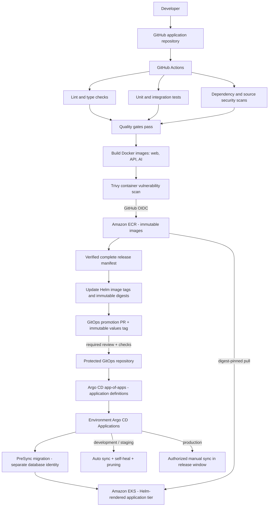

# Asteriq AI GitOps and Argo CD

This folder is the seed for a **separate GitOps repository**. Copy its contents
to the root of that repository, configure actual repository URLs, EKS endpoints,
SSO groups and environment settings, and protect its `main` branch. Application
source/Helm charts remain in the application repository.



This delivery flow is implemented by `.github/workflows/main.yml` and
`.github/workflows/gitops-promotion.yml` in the application repository.
The complete release contains all three images; promotion updates their Helm
values together. Tags identify the source commit and workflow run, while
`image.digest` selects the exact scanned artifact. The GitOps PR is reviewed
before merge; Argo CD then reconciles the approved desired state. CI publishes
images and proposes Git changes, and Argo CD performs Kubernetes deployment.

## Repository structure

```text
bootstrap/                    privileged Argo installation/configuration examples
projects/                     one AppProject per workload environment
applications/                 three child Application definitions
environments/
  development/values.yaml
  staging/values.yaml
  production/values.yaml
  .../release.json            written only after a verified promotion
automation/validate.py         protected-main policy validator
.github/workflows/validate.yml GitOps PR checks
.github/CODEOWNERS.example     rename/configure as CODEOWNERS
```

The application repository's `.github/workflows/gitops-promotion.yml` proposes
changes using `scripts/gitops/promote.py`. The existing Main pipeline builds,
tests/scans and publishes the same three images to ECR through AWS OIDC.
No AWS access keys are added to GitHub Secrets.

## Workflow and promotion

1. A reviewed application change merges to `main`. Existing Main quality gates
   now include Helm and GitOps regressions; Docker/Trivy gates precede ECR push.
2. Images receive traceability tags `commit-run_id-run_attempt`; the release
   artifact records three immutable digests and the linux/amd64 platform.
3. A completed successful Main workflow triggers a development promotion PR
   when `GITOPS_REPOSITORY` is configured. Provenance checks reject fork/PR runs,
   failed/incomplete runs, another repository, mixed artifacts and unapproved images.
4. Promotion changes only the environment's values/release record and its chart
   source pin. It creates a unique GitOps branch and immutable snapshot tag, then
   opens a PR. It never merges that PR or calls Kubernetes/Argo sync from CI.
5. After required GitOps review/checks, the app-of-apps updates the child
   Application definition. Development/staging automatically reconcile workloads.
6. Dispatch the same workflow/run ID to staging, then production. The promoter
   requires the exact commit/run/attempt/image tuple already approved in the
   preceding environment. It does **not** infer live health from Git: reviewers
   must verify Argo health, business smoke tests and load/security evidence.

Every child Application uses two sources: the application Git commit for the
umbrella chart and an immutable `refs/tags/release/<environment>/...` GitOps
snapshot for values. These pins change together in one reviewed Application
update, preventing a chart/values mismatch during app-of-apps reconciliation.
Image digests override tags; no image updater follows `latest` or edits production
outside the promotion PR. Retain active and rollback digests in ECR lifecycle policy.

Promotion writes `image.tag` as `<full-commit-SHA>-<run-id>-<attempt>` alongside
`image.digest`. This is the exact tag published by Main, and ECR repositories
use immutable tags. The digest remains the Kubernetes image reference.
The workflow commits and pushes the change to a GitOps promotion branch and
opens a PR; after merge into protected `main`, Argo automatically deploys
development/staging. Production retains its reviewed manual-sync controls.

See [Argo CD multiple sources](https://argo-cd.readthedocs.io/en/stable/user-guide/multiple_sources/).

## Synchronization, drift and pruning

| Environment | Auto sync | Self-heal             | Pruning                                | Controls                                                                                         |
| ----------- | --------- | --------------------- | -------------------------------------- | ------------------------------------------------------------------------------------------------ |
| development | enabled   | enabled               | automatic, nonempty desired state      | reviewed desired-state PR                                                                        |
| staging     | enabled   | enabled               | automatic, nonempty desired state      | exact development release + evidence                                                             |
| production  | disabled  | manual reconciliation | explicit approved full sync with prune | protected PR, GitHub environment approval, current image rescan, restricted RBAC, release window |

Argo continuously compares Git-rendered resources with live state. In development
and staging, out-of-band edits are restored automatically; deletion from desired
state prunes managed resources. `allowEmpty: false` reduces accidental empty-app
deletion. CI also rejects disabling required components. Production drift remains
`OutOfSync` for review and an authorized reconciliation; auto-heal is deliberately
not enabled there. Configure notifications for OutOfSync/Degraded/sync failure.

The HPA-owned `/spec/replicas` field is ignored only in staging/production, with
`RespectIgnoreDifferences=true`. Development's fixed replica count still heals.
`PruneLast`, foreground propagation and shared-resource failure are enabled.
Secrets, Namespaces, cluster RBAC and database resources are outside workload
projects and are not pruned by these Applications. Application finalizers are
omitted and app-of-apps pruning is disabled; decommission requires a separate
reviewed procedure. Removing an Application file does not authorize mass deletion.

Policy semantics follow [automated sync](https://argo-cd.readthedocs.io/en/stable/user-guide/auto_sync/)
and [sync options](https://argo-cd.readthedocs.io/en/stable/user-guide/sync-options/).

## Production restrictions

- Configure protected GitHub environment `gitops-production`: required reviewers,
  no self-review, protected-main dispatches, no administrator bypass where supported.
- Require GitOps PR checks and CODEOWNERS approval; use two reviews for production
  changes. Protect application/control-plane/policy changes with platform owners.
  The PR bot must not bypass branch protections or merge its own PR.
- Protect `release/*` tags against update/deletion; permit the bot to create new
  tags only. Rejected PRs may leave unused tags, which are not active desired state.
- The production workflow re-scans all three ECR digests for High/Critical
  vulnerabilities using a read-only ECR role authenticated through OIDC before
  acquiring GitOps write credentials.
- Production AppProject permits only its exact repository URLs, EKS server,
  namespace and required application resource kinds. Release managers have get/sync,
  not Application/project update/delete, exec or cluster-admin privileges.
- The example allow window is **Monday–Friday, 14:00–16:00 Asia/Kolkata**.
  Manual overrides are disabled. Adjust this reviewed project policy to the
  organization's release schedule; start with enough buffer for migrations/rollouts.

The app-of-apps project targets the Argo namespace and is a privileged trust
boundary even with an Application-only kind whitelist. Only platform administrators
may change its trusted repository/composition. Projects themselves remain
administrator-managed and are not auto-applied from the workload root.
See [project isolation](https://argo-cd.readthedocs.io/en/stable/user-guide/projects/)
and [sync windows](https://argo-cd.readthedocs.io/en/stable/user-guide/sync_windows/).

## Migration gate

GitOps values enable the umbrella's optional PreSync Job. It uses the same API
image digest, existing `migration` ServiceAccount and `migration-secrets` database
identity. Successful Jobs are removed; failed Jobs remain for diagnostics until
TTL cleanup. A migration failure blocks workload sync. The existing runner locks,
checksums and transaction handling remain unchanged.

Use full Application synchronization: selective resource sync can bypass hooks.
Self-healing full sync may run the migration check again; already-applied files
are no-ops. Application retry is bounded. Never give runtime database users DDL
privileges. Platform Namespace, network rules, migration account/Secret and RDS
trust ConfigMap must exist before initial synchronization.

## Rollback

Prefer a reviewed **Git rollback** so desired state and deployed state agree:

1. Identify the previous healthy source commit and complete three-image digest tuple.
2. Prepare a rollback branch restoring that tuple and source pin. Create a **new**
   immutable GitOps values tag and point the Application at it; do not move an
   existing release tag. Include an incident/evidence reference in the release record.
3. Preserve the forward migration catalog when needed. The existing runner rejects
   missing already-applied migrations, so reverting to an older migration image
   may block sync even when application code is backward-compatible. Set
   `migration.image.repository/digest` to an approved newer API runner with the
   complete applied catalog. Record `promotion.action: rollback` and
   `promotion.migration_image` with its exact URI. Normal promotions clear this override.
4. After review, development/staging reconcile automatically. Production requires
   an authorized full manual sync within its window, with pruning only after diff review.
5. Validate authentication, quotes, trades, balances, alerts and AI behavior; monitor
   latency/errors. Rolling back images does not roll back financial data or DDL.

Argo's history rollback is an emergency alternative for manual-sync production;
immediately reconcile Git to the chosen state. Automated sync can reject/undo an
imperative rollback, so a Git change is the normal path. Use expand/contract schema
changes and backups; destructive database recovery requires its own procedure.

## Bootstrap and credentials

Install an approved, pinned Argo CD release supporting multi-source Applications
and `automated.enabled` (Argo CD 3+), with the supplied chart values example.
Configure actual SSO before disabling local admin. Keep the API/UI private or
expose through a separately secured TLS administration endpoint.

Set annotation resource tracking: the workload Helm release name remains
`asteriq`, preserving selectors, while Argo Applications have environment-specific
names. Register each EKS destination with least-privilege cluster credentials,
private control-plane connectivity and validated CA trust. Provision read-only
Git credentials for Argo; do not reuse the CI PR-writer token.

Configure repository variables `GITOPS_REPOSITORY`, `GITOPS_BRANCH` (default main),
`GITOPS_APP_CLIENT_ID`, build-account `IMAGE_BUILD_ACCOUNT_ID` / `IMAGE_BUILD_REGION`
(or the existing publication AWS variables), and `ECR_PREFIX`. Store only the
GitHub App private key as `GITOPS_APP_PRIVATE_KEY`; its installation token is
short-lived and scoped to the GitOps repository's contents/PR permissions.
Set `AWS_ECR_READ_ROLE_ARN` for production, scoped only to the three build-account
ECR repositories and trusted for the `gitops-production` OIDC environment subject.
EKS node roles need pull permissions, including cross-account repository policies
if build and environment accounts differ. CI does not receive EKS credentials.

Replace all placeholders and configure production host/sender/certificate values
in `environments/*/values.yaml`. Rename CODEOWNERS.example and enable its rules.
The seeded validation workflow checks candidate state with the policy script from
protected main, not PR-modified validation code. Update that trusted policy under
platform review when changing legitimate resource contracts.
Set `APP_REPOSITORY` (owner/name) in the GitOps repository for source allowlisting.
Its checks fetch tags and compare candidate values/Application/release records
with the actual immutable snapshot Argo will read, not just the candidate files.

After Argo/cluster/secret setup, platform administrators apply projects and the
bootstrap boundary explicitly; no script in this task contacts a live Argo server:

```powershell
kubectl --context YOUR_MANAGEMENT_CONTEXT apply -k gitops/projects
kubectl --context YOUR_MANAGEMENT_CONTEXT apply -f gitops/bootstrap/project.yaml
kubectl --context YOUR_MANAGEMENT_CONTEXT apply -f gitops/bootstrap/application.yaml
argocd app diff asteriq-production
argocd app sync asteriq-production --prune
argocd app wait asteriq-production --health --sync --timeout 600
```

The existing ECS deployment workflow remains available; select the intended
deployment path and stop competing imperative/Helm/Kustomize management when
handing workloads to Argo. This implementation provides manifests and automation;
actual GitHub protections, credentials, Argo registration and AWS provisioning
require the organization's target settings and authorization.

## Validation evidence

The combined Helm/GitOps suite passes 65 tests. These check policy restrictions,
environment identity, immutable source/value pins, exact three-image promotion,
source-environment agreement, hook image/identity, snapshot-tag consistency,
repository allowlisting, rollback runner behavior and the existing chart suite.
Formatting and Python syntax checks pass. CI and Argo/EKS integration are defined
but were not executed against live GitHub/Argo/AWS targets during implementation.

## Seven-workload App-of-Apps alternative

See [app-of-apps/README.md](app-of-apps/README.md) for separate web, API, AI, monitoring, logging, ALB controller and cert-manager children in each environment. Choose one deployment ownership model per cluster; this alternative uses reviewed manual promotion PRs rather than the umbrella publisher.
