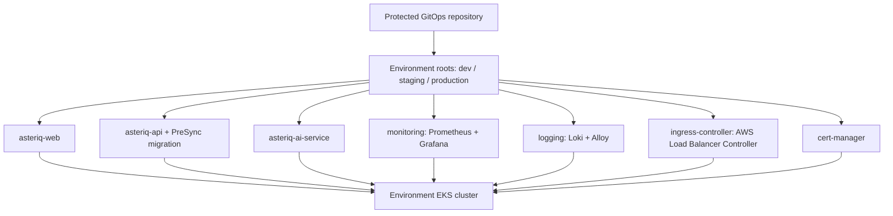

# Asteriq App-of-Apps

This is an alternative to the umbrella Applications in `../applications`.
Copy `gitops/` to the separate GitOps repository as described in its README.
Never install both patterns against the same environment: they own the same
Deployments and Services. Each environment assumes a separate EKS cluster;
cluster controllers must be installed exactly once per cluster.

## Layout and ownership

`roots/` contains three root Applications. `environments/<environment>/`
contains seven children and a Kustomization. `values/<environment>/` separates
runtime settings from Application definitions. `projects/` separates root,
application, and privileged platform permissions. `migration/` is a small
hook-only Helm chart; `bootstrap/` contains a health customization patch.

Roots manage Application objects in the management cluster's `argocd`
namespace. Children deploy to their environment EKS endpoint. Application
projects cannot create cluster resources or Secrets. Platform projects allow
CRDs, cluster RBAC, admission webhooks and IngressClass, plus namespaced chart
resources. Treat changes to roots, projects, chart versions and platform values
as administrator code: protect them with CODEOWNERS and mandatory review.
The Kubernetes credentials registered in Argo CD must also enforce these bounds.

## Configure and bootstrap

1. Register three EKS clusters and both private Git repositories in Argo CD.
   Configure ECR node/pod image pull permissions; no AWS access keys belong here.
2. Replace every `REPLACE_*` value and sample ECR account with actual values.
   Pin application source and values revisions to immutable Git commits; select
   reviewed, exact upstream chart versions, never `latest` or version ranges.
   Validate chart compatibility with the target Kubernetes version. Infrastructure
   chart versions deliberately require operator approval rather than guessed pins.
3. Pre-create `asteriq-dev`, `asteriq-staging`, `asteriq-production`,
   `monitoring` and `cert-manager` namespaces in their respective clusters.
   Provision existing app Secrets, migration Secret/ServiceAccount, RDS CA
   ConfigMap, managed-service NetworkPolicies and IAM roles using the existing
   `k8s/security` configuration. Configure S3/IRSA and EBS CSI storage for Loki
   and Prometheus. Create `grafana-admin` with `admin-user` and `admin-password`.
   No database or Redis instance is installed by this tree.
4. Merge `bootstrap/application-health.yaml` into the existing `argocd-cm`:
   `kubectl --context MANAGEMENT -n argocd patch configmap argocd-cm --type merge --patch-file gitops/app-of-apps/bootstrap/application-health.yaml`.
   Preserve existing SSO/settings. Enable annotation resource tracking as in
   `../bootstrap/argocd-values.example.yaml`.
5. Apply projects with `kubectl --context MANAGEMENT apply -k gitops/app-of-apps/projects`.
   Install one root with `kubectl --context MANAGEMENT apply -f gitops/app-of-apps/roots/dev.yaml`.
   Repeat for staging and production after their settings are reviewed.

Wave order is ingress (-30), cert-manager (-20), monitoring/logging (-10), AI
(0), API (10), web (20). The custom Application health check requires both
Synced and Healthy before the root advances. This orders initial reconciliation;
children reconcile independently after creation, so it is not a transactional
release barrier. A failed infrastructure child intentionally blocks later waves.
Production children must be manually synchronized in this order while the root
sync is progressing; root synchronization alone does not deploy their workloads.

Development/staging roots self-heal Application definitions without pruning
children. Their application children self-heal and prune; infrastructure children
self-heal with pruning disabled. Production roots/children have no automated
policy. Production workload/platform projects restrict sync to weekdays
14:00–16:00 Asia/Kolkata without manual bypass. Configure organization SSO/RBAC
so only release managers can sync production and platform admins can change
projects; root control-plane access is an administrative privilege.

## Workload details

The API child includes an immutable-image PreSync migration Job. Keep its API
image and source revision aligned with the API chart; migration credentials are
separate from runtime credentials. API readiness verifies database/schema state.
Failed migrations block API deployment. Hooks are idempotent and may run again
on subsequent syncs. On rollback, retain a forward-compatible migration catalog;
never automatically revert financial database changes.

Monitoring installs kube-prometheus-stack with bundled Grafana behind ClusterIP.
Application and business metrics are exposed at private `/metrics` endpoints
and continue through CloudWatch EMF. The monitoring child includes Asteriq
ServiceMonitors and alert rules; provision the scrape NetworkPolicies separately
through the namespace/security owner. See the Prometheus runbook at
`../../k8s/monitoring/prometheus/README.md`. Logging installs distributed Loki, Alloy and the
existing collector ConfigMap. ALB HTTPS uses ACM, configured in frontend ingress
values; cert-manager handles Kubernetes certificates separately and does not
issue ACM certificates. No issuer or DNS challenge credentials are auto-created.

## Promotion, rollback and drift

Open a reviewed PR that updates the three application children to one tested
source commit, immutable image digests, their immutable values commit, and the
matching migration values. Promote that exact tuple dev → staging → production
after health, integration and financial correctness checks. Run Helm rendering
and upstream chart validation before merging. The existing umbrella promotion
workflow does **not** publish this alternative layout; use a reviewed promotion
PR for this tree until a dedicated publisher is configured.

Revert the release tuple in Git to roll back application images; database changes
require a separately reviewed forward recovery plan. Argo CD reports live drift
as OutOfSync, automatically repairs development/staging drift, and leaves
production correction to an authorized sync. Infrastructure deletions require
explicit reviewed pruning; no cascading deletion finalizers are configured.

App-of-Apps gives each environment one entry point while keeping each workload's
health, history, permissions and release lifecycle independent. Adding a child
Application in Git makes it discoverable and consistently managed by the root;
shared policies and review replace repetitive manual registration.

References: [Argo CD Application health](https://argo-cd.readthedocs.io/en/stable/operator-manual/health/),
[sync waves](https://argo-cd.readthedocs.io/en/latest/user-guide/sync-waves/),
[cert-manager Helm installation](https://cert-manager.io/docs/installation/helm/).
