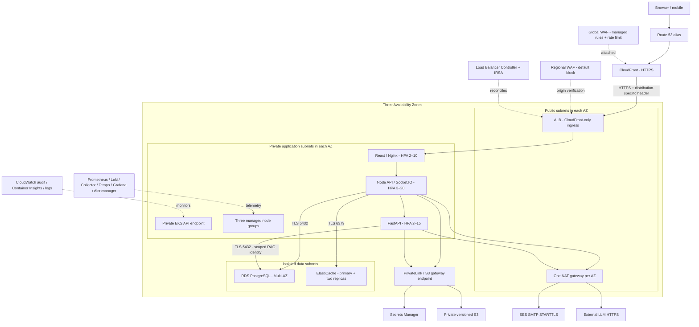

# Asteriq AI on Amazon EKS

This is an **account-free architecture and deployment demo**. Terraform tests
use mocked AWS providers and Helm renders locally. No AWS account, live EKS
cluster or paid resources are used. The ECS/Fargate stack remains a separate
deployment option.

## Architecture



WAF is attached to CloudFront. The Load Balancer Controller creates ALBs,
listeners and pod target groups; it does not proxy requests. Only frontend is
Internet-facing. Nginx proxies API and Socket.IO to the private API Service,
which calls the private AI Service. AI's authenticated callbacks to API remain
allowed by the application network policies.

The public ALB accepts HTTPS only from the CloudFront origin-facing prefix list.
Regional WAF additionally requires the distribution-specific `X-Asteriq-Origin`
header: the prefix list alone permits other distributions. Edge Terraform attaches
the origin WAF before enabling CloudFront/DNS. Rotate the header at both ends
with overlap; restrict configuration/state readers because it is a credential.

CloudFront leaves dynamic API, authentication and WebSocket requests uncached,
forwards viewer headers/cookies/query strings, and caches only versioned
`/assets/*`. Error caching is disabled. Viewer and origin connections use HTTPS.
CloudFront ACM is in `us-east-1`; ALB ACM is regional and covers the application
and origin names. Foundation owns the shared DNS validation record, avoiding
two Terraform states managing one Route 53 record.

## Files and account-free demo

| Path | Purpose |
| --- | --- |
| `foundation/` | VPC, EKS, private node groups, IRSA, managed add-ons, data services, ECR, S3, SES and Secrets Manager |
| `edge/` | CloudFront, global/regional WAF, viewer certificate and DNS aliases |
| `platform/` | Controller/autoscaler values, gp3 storage, secrets and application overrides |
| `demo/application-values.yaml` | Fake identifiers and zero image digests for rendering only |
| `scripts/kubernetes/demo_eks.py` at repository root | Local renderer; never applies resources or calls AWS |

From the repository root:

```powershell
python scripts/kubernetes/demo_eks.py
helm lint helm/asteriq-platform -f helm/asteriq-platform/values-production.yaml -f infrastructure/eks/demo/application-values.yaml
terraform -chdir=infrastructure/eks/foundation init -backend=false
terraform -chdir=infrastructure/eks/edge init -backend=false
terraform -chdir=infrastructure/eks/foundation validate
terraform -chdir=infrastructure/eks/edge validate
terraform -chdir=infrastructure/eks/foundation test
terraform -chdir=infrastructure/eks/edge test
```

Initialization downloads public provider packages without contacting an AWS
account. Tests explicitly use mock providers and synthetic versions/secrets;
these versions are test fixtures, not deployment recommendations. The renderer
produces `.runtime/eks-demo.yaml` marked **DO NOT APPLY** with intentionally
nondeployable fake ARNs, nonexistent domain and zero digests. It renders 20
resources and does not simulate cloud performance or run application pods.

## Network and Kubernetes security

| Boundary | Implemented control | Production follow-up |
| --- | --- | --- |
| EKS administration | Private-only API; explicit access entries; creator admin disabled | VPC-connected CI, VPN or SSM-managed host; SSO/MFA for humans |
| Nodes | Private subnets, AL2023 managed groups, encrypted gp3 disks, no SSH configuration | Patch reviewed AMIs, test upgrades and reserve surge capacity |
| Node credentials | IMDSv2 required, hop limit 1 | IRSA for pods; host-network workloads remain privileged |
| Pods | Existing non-root, read-only filesystem, dropped capabilities and restricted namespace settings | Apply namespace policies before workloads; isolate CNI/logging exceptions |
| Pod networking | VPC CNI network-policy feature enabled | Apply and test canonical default-deny policies, DNS and service-specific allowances |
| Data services | Isolated subnets, private endpoints, SG permits only database ports from cluster nodes | NetworkPolicy narrows API/AI access; node SG is not a per-service identity |
| AWS APIs | ECR, STS, Secrets Manager, Logs, EC2 and Auto Scaling interface endpoints; S3 gateway | Permit private endpoint CIDRs on 443; IAM provides authorization |
| Internet egress | Per-AZ NAT for LLM HTTPS and SES SMTP | Existing policies constrain ports/IPs, not hostnames; use an egress proxy/firewall when required |
| Secrets | EKS KMS envelope encryption, scoped SecretStore, Secrets Manager | Restrict Secret/exec readers and test rotation/restart |

ALB/frontend/API/AI connections remain private HTTP. NetworkPolicy does not
encrypt them; use internal TLS or a tested mesh for that requirement. Security
Groups for Pods can strengthen per-service data isolation but require a separate
CNI and capacity design.

The endpoint NetworkPolicy is additive to default-deny. Replace its demo CIDRs
with actual application subnets: public-only HTTPS egress cannot reach PrivateLink.
External Secrets Operator needs AWS/Kubernetes API access in its own namespace.
Confirm CloudFront prefix-list security-group rule quota. Verify the actual
CloudFront → ALB → Nginx header chain before using `TRUST_PROXY_HOPS=3`, and do
not expose another direct API route with that trust configuration.

## IAM and secret controls

Every IRSA trust policy binds the cluster OIDC issuer, `aud=sts.amazonaws.com`
and exact namespace/service-account subjects. Application permissions are not
placed on the node role.

| Role | Service account | Permissions |
| --- | --- | --- |
| CNI | `kube-system/aws-node` | AWS CNI policy |
| EBS CSI | `kube-system/ebs-csi-controller-sa` | EBS CSI policy |
| CloudWatch | Agent/Fluent Bit in `amazon-cloudwatch` | CloudWatch agent server policy |
| Load Balancer Controller | `kube-system/aws-load-balancer-controller` | Vendored official v3.6.0 policy; pin matching controller chart |
| Cluster Autoscaler | `kube-system/cluster-autoscaler` | Capacity reads; resize only this cluster's tagged ASGs |
| Secret reader | `asteriq-ENV/secrets-reader` | Get/describe this environment's application secrets only |
| API / AI | Exact application service accounts | Separate S3 object prefixes |

Node IAM includes EKS worker/ECR pull only. Application secret readers cannot
read the RDS administrator secret. The application deployment role has
namespace-scoped EKS Edit access; only the separate administrator role has
cluster-admin for platform bootstrap. Namespace editors can still expose
application secrets through workloads, so restrict this role to trusted release
automation. Use short-lived SSO/OIDC roles and audit assumptions.

Secret containers are created without values. Populate API DB, RAG DB, migration
DB, Redis, JWT, LLM and SMTP credentials out of band. External Secrets syncs
them to Kubernetes; restrict controller RBAC and verify reload after rotation.
Redis uses ephemeral Terraform input and a write-only provider field. The
CloudFront origin header does enter state because its AWS API is not write-only:
use the supplied KMS-encrypted, versioned, locked remote backend with restricted
roles. Do not publish real state or plans.

The application uses SES SMTP. Pod IAM credentials do not authenticate SMTP.
Terraform creates a sender-scoped SMTP IAM user without access keys; create and
rotate its SMTP credentials securely out of band and store SMTP_URL in Secrets
Manager. S3 roles provide infrastructure permission; application S3 integration
and per-user object authorization remain separate responsibilities.

## Managed services

| Service | Provisioned behavior | Required follow-up |
| --- | --- | --- |
| RDS PostgreSQL | Multi-AZ, encrypted gp3, forced TLS, 35-day backups, managed admin secret, deletion protection/final snapshot | Separate API/RAG/migration DB identities; `vector`/`pgcrypto`; CA verification; tested point-in-time restore |
| ElastiCache Redis | TLS and authentication, encryption, two replicas, automatic failover, snapshots | Store rediss URL securely, test token rotation and reconnect/failover |
| S3 | Private access block, versioning, encryption and TLS-only bucket policy | Approved retention/backups, application ownership checks; customer-managed keys if required |
| SES | Verification, DKIM, custom MAIL FROM/SPF and restricted sender | Sandbox exit, reviewed DMARC preserving existing DNS, bounce/complaint handling |
| Secrets Manager | Separate environment secret containers | Populate/rotate outside Terraform, restrict editors and verify sync |

Multi-AZ RDS improves availability but not PostgreSQL connection capacity. Budget
connections for up to 20 API pods plus AI, migration and administration; introduce
a tested pooler/RDS Proxy if necessary. Redis/logs are not the financial ledger.
Reused data modules use service-managed encryption/SSE-S3; add customer-managed
keys when organizational policy requires them.

## Scaling, storage and observability

One on-demand managed node group per AZ provides the baseline. Cluster Autoscaler
owns desired counts after bootstrap, while Terraform owns min/max. Separate AZ
groups support AZ-bound EBS volumes. Pin the autoscaler Kubernetes minor and
configure discovery with generated ASG tags.

HPAs remain frontend 2–10, API 3–20, AI 2–15 using CPU/memory. Install Metrics
Server; optional Prometheus metrics are in the
[autoscaling guide](../../k8s/autoscaling/README.md). HPA adds pods; node scaling
adds compute for pending pods. Budget IPs, quotas, surge and monitoring capacity.
Karpenter is a future option for bursty demand or varied CPU/memory/GPU/Spot
needs; keep independent system-node capacity and configure scoped IAM,
interruption handling, NodePool limits and disruption budgets. It is not installed
by this managed-group baseline. Do not give both autoscalers the same capacity.

The gp3 StorageClass encrypts volumes, waits for consumer placement and retains
volumes on deletion. EBS is AZ-bound, not multi-AZ storage. Loki/Tempo require
their own replicated/object-storage recovery design. PDBs cover voluntary
evictions, not HPA replica reductions.

All five EKS control-plane logs have 90-day retention. The CloudWatch Observability
add-on provides Container Insights and workload logs; inspect both agent and
Fluent Bit IRSA annotations. Configure their emitted log-group retention before
production; it is not automatically covered by the control-plane setting.
Prometheus/Loki/Tempo/Grafana/Alertmanager remain the shared application stack.
Choose collector ownership deliberately to avoid duplicate log ingestion.

Global WAF logs blocked requests with URI, query, auth/cookie and origin-header
redaction; sampling is disabled. ALB raw access logs are not enabled because
the existing auth flow can place tokens in URLs. A restricted bucket is reserved
for an approved logging design. Organization CloudTrail, Config and GuardDuty
EKS protection are recommended production account controls, not provisioned
by this demo. Alert on audit/IAM changes, WAF spikes, node/data failures and
telemetry/recovery failures; correlate application logs with trace IDs.

## Future live deployment sequence

1. Choose account, Region, hosted zone, operator roles and VPC-connected runner.
   Pin supported EKS/AL2023/add-ons/charts and scanned image digests. Existing
   DNS, Secrets Manager or data resources need explicit import or migration plans.
2. Bootstrap remote state, fill foundation inputs, review a saved plan and apply
   that exact plan using its separate EKS backend. These roots do not migrate ECS.
3. Create an explicit kubeconfig context from the private administration path.
   Verify nodes/add-ons. Install pinned Load Balancer Controller, Cluster
   Autoscaler, Metrics Server, ESO and observability charts with generated IRSA.
4. Apply restricted namespaces and network policies, including endpoint egress.
   Populate application secrets, verify ExternalSecret readiness and distribute
   the verified RDS CA. Prepare separate least-privilege database identities.
5. Run reviewed migrations with the migration identity. Fill application overrides
   from foundation outputs, replace domains/CORS/certificates/images, render and
   reconcile using the existing deployment ownership path. Verify private targets.
6. Fill edge inputs with the ALB name, foundation validation FQDN and securely
   generated origin header. Apply the reviewed edge plan: origin protection
   precedes CloudFront/DNS cutover. Disable controller WAF reconciliation as in
   the provided values; edge Terraform owns that association.
7. Verify HTTPS, cache isolation, direct-origin rejection, authenticated WebSockets,
   API/AI callbacks, database TLS, email, WAF false positives, scaling and drain.
   AI responses must fit the configured 120-second origin timeout or use jobs.
8. Exercise AZ loss, database/cache failover and backup restore; define measured
   RTO/RPO, rollback and incident runbooks before production readiness.

Managed WAF rules and the initial rate limit need realistic auth, upload, trading
and NAT-shared-client testing. Use narrow reviewed exceptions, not blanket
inspection removal.

## Validation and limits

Both Terraform roots validate and pass mocked security plans. Helm lint passes;
20 application resources render. This establishes configuration consistency,
not live IAM/network behavior, add-on compatibility, recovery or performance.
No real Terraform plan, AWS deployment or cost estimate was generated.

References: [EKS private nodes](https://docs.aws.amazon.com/eks/latest/userguide/create-managed-node-group.html),
[EKS identity controls](https://docs.aws.amazon.com/eks/latest/best-practices/identity-and-access-management.html),
[Load Balancer Controller](https://kubernetes-sigs.github.io/aws-load-balancer-controller/latest/deploy/installation/),
[CloudFront WebSockets](https://docs.aws.amazon.com/AmazonCloudFront/latest/DeveloperGuide/distribution-working-with.websockets.html),
[ACM DNS validation](https://docs.aws.amazon.com/acm/latest/userguide/dns-validation.html),
[EKS supported versions](https://docs.aws.amazon.com/eks/latest/userguide/kubernetes-versions.html).
