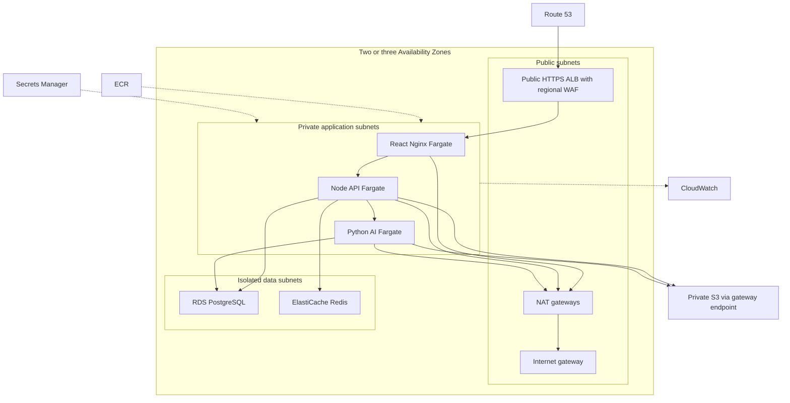

# Asteriq AI AWS infrastructure

Reusable Terraform modules with independent dev, staging, and production roots.
No credentials or application secret values are embedded in configuration.

| Directory                               | Responsibility                                                                 |
| --------------------------------------- | ------------------------------------------------------------------------------ |
| `bootstrap`                             | Versioned, KMS-encrypted state bucket with destruction protection              |
| `environments/{dev,staging,production}` | Separate backend, provider identity, and inputs                                |
| `modules/vpc`                           | VPC, public/application/data subnets, IGW, NAT, routes, S3 endpoint, flow logs |
| `modules/security`                      | Explicit service-to-service security group rules                               |
| `modules/alb`                           | Public HTTPS ALB, health checks, access logs                                   |
| `modules/ecs`                           | Fargate services, Cloud Map DNS, IAM roles, autoscaling                        |
| `modules/ecr`                           | Immutable image repositories                                                   |
| `modules/rds`                           | Private PostgreSQL, backups, managed administrator secret                      |
| `modules/redis`                         | Private authenticated Redis with TLS and replicas                              |
| `modules/s3`                            | Private versioned object and ALB access-log buckets                            |
| `modules/cloudwatch`                    | Logs and encrypted SNS alarm topic                                             |
| `modules/observability`                 | Operations/SLO dashboards, metric alarms, and error-budget burn alarms         |
| `modules/secrets`                       | Secret containers populated outside Terraform                                  |
| `modules/route53`                       | ACM certificate validation using an existing public hosted zone                |
| `modules/stack`                         | Composition, DNS alias, regional WAF, alarms, production guardrails            |



This implementation preserves the existing three-service release contract:
React runs in the web/Nginx container, which proxies REST and WebSocket requests
to the private API. Cloud Map resolves API and AI service addresses. CloudFront
with S3 frontend hosting and SES provisioning are separate extensions to this
baseline; it uses regional WAF protection and externally configured SMTP.

## Requirements

Use Terraform 1.11+ and AWS provider 6.x. Commit the generated provider lockfiles.
Authenticate through AWS SSO or an assumed IAM role; use GitHub OIDC for CI.
Never put access keys in HCL, backend files, or tfvars.

Supply an existing Route 53 public hosted zone, two or three regional AZs, and
scanned ECR image digests. Verify regional PostgreSQL 16 availability and the
required `vector` and `pgcrypto` extension support.

Prefer separate AWS accounts per environment. Roots restrict the provider to
the expected account and enforce their environment names. Unique resource
names, CIDRs, and state keys separate shared-account environments, but state-key
separation also needs IAM restrictions to provide an authorization boundary.

Production requires per-AZ NAT, Multi-AZ RDS, Redis replicas, two tasks per service,
and 90-day logs. Dev examples reduce redundancy to lower cost.

## Remote-state bootstrap

Initialize `bootstrap`, then review and apply a plan supplying `region`,
`account_id`, and a globally unique `bucket_name` through non-secret variables.
Bootstrap initially uses local state because the remote bucket does not yet exist.
Securely retain this state; after creation, add `backend "s3" {}` and migrate it
using `init -migrate-state` and a dedicated `bootstrap/terraform.tfstate` key.
The bucket and KMS key have `prevent_destroy` protection.

Copy each environment's `backend.hcl.example` to ignored `backend.hcl`. Replace
the bucket, region, account ID, and KMS ARN. Keep the distinct state key supplied
for each environment:

```sh
terraform -chdir=infrastructure/terraform/environments/dev init -backend-config=backend.hcl
```

Backend roles need `s3:ListBucket`, `GetObject`/`PutObject` on their state key,
`GetObject`/`PutObject`/`DeleteObject` on its `.tflock` key, and KMS encryption,
decryption, and data-key permissions. Scope roles to their environment paths and
restrict key access. Configure CloudTrail state-access auditing in the account.
The backend uses KMS encryption and native S3 locking.
[HashiCorp backend reference](https://developer.hashicorp.com/terraform/language/backend/s3).

## First rollout

1. Copy `terraform.tfvars.example` to ignored `terraform.tfvars`. Replace account,
   region, AZs, DNS, email, and image inputs. Image repositories must use
   `asteriq-ENVIRONMENT/SERVICE` and immutable SHA-256 digests.
2. Supply `TF_VAR_redis_auth_token` from a secure secret store. Use a random
   32-128 character alphanumeric value. The ephemeral input and write-only
   provider argument keep it out of state and plans. Supply it for both plan and
   apply; preserve it across runs. Increment `redis_auth_token_version` when
   rotating, and coordinate the Redis token, application secret, and task rollout.
3. Provision the foundation first: ECR, secrets, RDS, and Redis. For this initial
   bootstrap only, target `module.asteriq.ecr`, `module.asteriq.secrets`,
   `module.asteriq.rds`, and `module.asteriq.redis`. Their dependencies provision
   networking. Format-valid image inputs are required even at this stage; use
   actual published digests before a full plan. Avoid targeting in routine runs.
4. Publish scanned images using the publisher OIDC role from the existing
   `infrastructure/iam/publish-*` templates, with the environment's ECR prefix.
   The Main workflow publishes production; dev/staging need environment-specific
   publishing configuration.
5. From a controlled runner in the VPC, retrieve the RDS-managed administrator
   secret, install extensions, and create restricted database application roles.
   Populate application secrets with these roles' credentials. Do not give runtime
   services the administrator secret. Use a separate migration role for privileged
   schema operations.
6. Populate each Secrets Manager container out of band. Values are entire strings,
   not JSON objects:

   | Secret suffix      | Value                                                    |
   | ------------------ | -------------------------------------------------------- |
   | `database-url`     | API PostgreSQL connection URL with TLS configuration     |
   | `rag-database-url` | AI PostgreSQL connection URL with TLS configuration      |
   | `redis-url`        | `rediss://:TOKEN@REDIS_ENDPOINT:6379`                    |
   | `jwt`              | Random JWT signing secret, at least 32 characters        |
   | `openai`           | Server-side API key                                      |
   | `smtp`             | SMTP connection URL with authentication and TLS/STARTTLS |

   URL-encode credentials. Configure database certificate verification and the
   appropriate RDS CA bundle in both images. RDS forces TLS. Verify your SMTP
   sender and production email access; `auth_email_from` is a plain email address.

7. Provision the cluster and task definitions before service tasks using initial
   targets `module.asteriq.ecs.aws_ecs_cluster.this` and
   `module.asteriq.ecs.aws_ecs_task_definition.this` and
   `module.asteriq.ecs.aws_ecs_task_definition.migration`. Populate the dedicated
   `migration-database-url` secret with a DDL-capable database role, distinct from
   the runtime roles. Run the migration definition once inside the VPC using the
   API security group and private subnets. Set GitHub's
   `ECS_MIGRATION_TASK_DEFINITION` from the deployment output. Service tasks have
   `RUN_MIGRATIONS=false`, and readiness requires an existing schema.
8. Review a full plan, apply it, and verify health, authentication, email, AI
   requests, and WebSockets:

   ```sh
   terraform -chdir=infrastructure/terraform/environments/dev plan -out=deployment.tfplan
   terraform -chdir=infrastructure/terraform/environments/dev apply deployment.tfplan
   terraform -chdir=infrastructure/terraform/environments/dev output deployment
   ```

Repeat for staging and production using their own accounts, backend files, and
inputs. No resources have been applied as part of creating these configurations.

## Existing deployment pipeline

Map `output deployment` to the variables in [the CI/CD guide](../../docs/ci-cd.md):
`ECS_CLUSTER`, the three service names, `SITE_URL`, and
`ECR_PREFIX=asteriq-production`. Container names remain `web`, `api`, `ai-service`.
Populate the production IAM policy template using actual task families and
execution/task role ARNs. Configure production approvals and main-only deployment.

Terraform ignores ECS service `task_definition` and `desired_count` after creation:
GitHub CD owns promoted revisions; autoscaling owns task counts. Terraform changes
to task settings create revisions but do not automatically roll them out.
Explicitly deploy reviewed configuration revisions before further image promotions;
the CD script copies the currently deployed task definition.

## Operations and security

- Only ALB TCP 443 is public. API/AI ingress is restricted to preceding service
  security groups. PostgreSQL and Redis are private and accept authorized tasks
  only. The default security group has no rules.
- Data subnets have no internet default route. Application HTTPS egress and API
  SMTP TCP 587 use NAT. S3 uses a gateway endpoint; other AWS APIs use HTTPS via NAT.
  Add interface endpoints if traffic, cost, and policy justify them. NAT does not
  filter outbound domains.
- Internal HTTP hops are private. Add internal TLS if required by your security
  policy. The current frontend uses WebSockets; adding Socket.IO polling requires
  affinity at the API tier, beyond web-tier ALB stickiness.
- Production RDS and ALB have deletion protection. RDS takes a final snapshot;
  change its final snapshot identifier if deleting a recreated database with the
  same name. S3/ECR refuse forced deletion of populated stores.
- State uses KMS encryption; other data services use AWS service encryption.
  Execution roles retrieve only their service's application secrets; task roles
  have scoped object-bucket access. Secret values are not managed or read by Terraform.
- Subscribe an operations destination to the output SNS topic so alarms notify
  people. Review WAF false positives, especially uploads. Logs must redact financial
  data and credentials. Replacing tasks is necessary after injected-secret rotation.
- Test backup restores and recovery procedures. Redis is a cache/coordination
  layer, not the authoritative financial database. Multi-AZ does not provide
  regional disaster recovery.

## Validation

The `Terraform` GitHub workflow checks every root and runs mocked composition
tests on infrastructure changes. It needs no AWS credentials and never applies
resources. Mocked tests reject reduced production redundancy and wrong-account
images.

```sh
terraform fmt -check -recursive infrastructure/terraform
terraform -chdir=infrastructure/terraform/environments/dev init -backend=false
terraform -chdir=infrastructure/terraform/environments/dev validate
terraform -chdir=infrastructure/terraform/modules/stack test
```

Repeat init/validate for staging, production, and bootstrap. These checks do not
prove AWS quotas, image availability, populated secrets, certificate issuance,
or runtime readiness. Review authenticated plans before applying.
