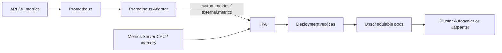

# Asteriq pod and node autoscaling

Production uses one `autoscaling/v2` HPA per Deployment. The standalone Helm
defaults, production umbrella/individual Helm and GitOps values, and production
Kustomize profile have matching bounds. Development and staging retain their
explicit smaller environment overrides.

| Workload | Minimum pods | Maximum pods | CPU target | Memory target |
| --- | ---: | ---: | ---: | ---: |
| Frontend | 2 | 10 | 65% | 80% |
| API | 3 | 20 | 65% | 80% |
| AI service | 2 | 15 | 65% | 80% |

Utilization is a percentage of **resource requests**, not limits or node capacity.
Both requests exist on every application container. These targets are initial
settings to tune against throughput and latency load tests, not capacity promises.
Kubernetes calculates a recommendation for each metric and selects the largest.
With three API pods at 100% CPU against a 65% target, the initial recommendation
is `ceil(3 * 100 / 65) = 5`, subject to readiness, missing metrics and behavior.

The existing behavior permits fast scale-up (100% or two pods per minute,
whichever is larger), stabilizes scale-down for five minutes, and removes at
most one pod per minute. HPA owns replicas in Helm Deployments; the Kubernetes
promotion script removes replica fields before applying existing workloads.
Pod disruption budgets cover voluntary evictions, not HPA replica reductions.

Memory HPA is useful when additional replicas reduce each pod's working set.
It does not fix leaks or reduce resident model memory. If an AI model normally
uses more than 80% of its memory request, increase an accurately measured request
or tune the target; otherwise HPA may stay at its ceiling. CPU/memory scaling
also cannot overcome PostgreSQL, Redis or external LLM capacity limits.

## Activate resource scaling

Install a reviewed Metrics Server version compatible with the EKS/Kubernetes
version. Verify `metrics.k8s.io` is available and kubelet certificates/network
access work; do not disable TLS verification to hide certificate problems.
Reconcile the normal production Helm or Kustomize deployment ownership path.
Do not apply a second HPA targeting the same Deployment.

```powershell
kubectl top pods -n asteriq-production
kubectl get hpa -n asteriq-production
kubectl describe hpa api -n asteriq-production
```

Ensure readiness/startup probes exclude warming AI pods from normal traffic.
Capacity must include deployment surge, DaemonSets, IP availability, and zone
spreading. Maximum application requests alone are 26 CPUs and 41.25 GiB memory
(frontend 10 × 100m/128Mi, API 20 × 500m/512Mi, AI 15 × 1 CPU/2Gi).
This excludes monitoring, system workloads and surge; size node pools accordingly.
Keep database pool-size × maximum API replicas within the connection budget.

## Prometheus custom metrics



Install a pinned `prometheus-community/prometheus-adapter` chart using
`prometheus-adapter-values.example.yaml`. Verify the Prometheus Service URL
against your release. The adapter translates existing counters/gauges into the
Kubernetes custom metrics API; Prometheus by itself does not serve this API.
Configure API aggregation/RBAC and permit adapter egress to Prometheus and the
Kubernetes API, plus control-plane access to the adapter Service. Use verified
APIService serving certificates for the selected chart version.

The ServiceMonitors must attach trusted `namespace` and `pod` target labels.
The supplied API/AI monitors do this through Kubernetes service discovery.
Keep one process per pod for these gauges, or implement correct aggregation.
Discovery and rate windows need warm-up; missing metrics are not zero load.
When one metric fails, Kubernetes can still scale up from other valid metrics
but generally skips scale-down. Alert on failed metric fetches.

Merge `custom-metrics-values.example.yaml` **after** production platform values.
For individual charts, use the corresponding child `autoscaling` block without
its `asteriq-api`/`asteriq-ai-service` wrapper. This adds metrics to the existing
HPA and preserves CPU/memory targets and replica bounds.

| Signal | Adapter metric | Initial per-pod target | Interpretation |
| --- | --- | ---: | --- |
| API HTTP throughput | `asteriq_http_requests_per_second` | 50 requests/sec | Sum of 2-minute counter rates, excluding health requests |
| API WebSockets | `asteriq_websocket_connections` | 500 connections | Current authenticated connections per pod |
| AI concurrency | `asteriq_ai_active_requests` | 8 requests | In-flight requests, not queued jobs |

Load-test these values and choose a target below latency/error saturation.
Existing WebSocket sessions do not rebalance automatically when new pods arrive.
Measure the busiest pod as well as averages; preserve connection draining and
client reconnect behavior when removing pods. The Redis Socket.IO adapter
supports cross-pod messaging; it does not migrate live TCP connections.
Frontend serves static assets and has no HTTP throughput exporter in this
profile, so its HPA remains CPU/memory based.

```powershell
helm template asteriq helm/asteriq-platform -f helm/asteriq-platform/values-production.yaml -f k8s/autoscaling/custom-metrics-values.example.yaml
kubectl get --raw '/apis/custom.metrics.k8s.io/v1beta1/namespaces/asteriq-production/pods/*/asteriq_http_requests_per_second'
kubectl get --raw '/apis/custom.metrics.k8s.io/v1beta1/namespaces/asteriq-production/pods/*/asteriq_websocket_connections'
```

## AI queue design

Asteriq currently handles synchronous AI requests and exports active requests.
There is no shared AI queue-depth gauge to enable safely. For queued processing:

1. Introduce a durable shared queue, bounded admission and idempotent workers.
   Scale the Deployment that actually consumes jobs. If workers are separate
   from FastAPI, give them a separate HPA rather than scaling the HTTP gateway.
2. Export `asteriq_ai_queue_depth{namespace="asteriq-production",queue="ai-requests"}`
   as a gauge of **waiting jobs**, including a genuine zero when empty. Report
   exporter freshness separately and never convert an unavailable queue to zero.
3. Enable the adapter's external rule and merge `ai-queue-values.example.yaml`
   after the custom-metrics profile. The design uses `External/AverageValue: 5`:
   a total backlog of 60 recommends approximately 12 workers, bounded to 2–15.
   Use a new worker-specific target if the consumer Deployment is different.
4. The adapter uses `max` to deduplicate multiple exporters of the same shared
   queue; do not sum duplicate observations. Partitioned queues need a different
   aggregation. Benchmark job service time, provider rate limits and concurrency.

The queue profile is a future design, not an instrumented queue implementation.
Helm replaces metric lists, so it retains the in-flight metric explicitly.

## Cluster Autoscaler and Karpenter on EKS

HPA changes pod counts. A node autoscaler adds compute when those pods cannot be
scheduled and removes eligible excess compute later.

| Choice | Capacity model | Use when |
| --- | --- | --- |
| Cluster Autoscaler | Changes desired sizes of existing EC2 Auto Scaling groups / managed node groups within their min/max bounds | Established node groups, predictable instance families, simpler existing operations or multi-cloud consistency |
| Karpenter | Provisions EC2 capacity from pending pod requirements through NodePools and EC2NodeClasses; consolidates eligible capacity | Bursty demand, varied instance sizes, Spot diversification, distinct CPU/memory/GPU workload requirements |

For Asteriq on Amazon EKS, prefer **Karpenter when AI/trading demand is bursty or
the API and AI workloads need different node shapes**. Use an on-demand baseline
for critical API capacity and interruption-tolerant capacity for retryable work.
Retain a small managed node group or other independent capacity for Karpenter
and essential system controllers so provisioner startup does not depend on itself.
If existing managed node groups already satisfy predictable demand, Cluster
Autoscaler is a reasonable simpler choice; there is no need to migrate solely
because HPA is enabled.

For Karpenter, pin a compatible release/AMI, scope controller IAM and node roles,
select reviewed subnets/security groups, set NodePool CPU/memory limits and
disruption budgets, configure interruption handling, and preserve PDBs and
graceful draining. CPU/memory limits bound provisioning but are not strict dollar
budgets. Validate EC2 quotas, subnet IP capacity, zone requirements, model startup
time and Spot recovery. Restrict GPU pools with taints/tolerations if introduced.
Do not let Cluster Autoscaler and Karpenter manage the same capacity; coexistence
needs separate ownership. EKS Auto Mode clusters already manage node provisioning,
so review that model before adding another controller.

References: [Kubernetes HPA](https://kubernetes.io/docs/concepts/workloads/autoscaling/horizontal-pod-autoscale/),
[Prometheus Adapter](https://github.com/kubernetes-sigs/prometheus-adapter/blob/master/docs/config.md),
[AWS Karpenter guidance](https://docs.aws.amazon.com/eks/latest/best-practices/karpenter.html),
[AWS node autoscaling](https://docs.aws.amazon.com/eks/latest/userguide/autoscaling.html).

## Validation

```powershell
python -m pytest scripts/kubernetes/tests/test_autoscaling.py -q
```

Tests render production Kubernetes and the basic, custom and queue Helm profiles;
check Deployment targets, requests, both resource metrics, replica bounds and
HPA ownership of replicas. Validate real Metrics Server/Adapter responses and
controlled load in staging before production activation. No live autoscalers
have been installed or workloads scaled by this repository change.
