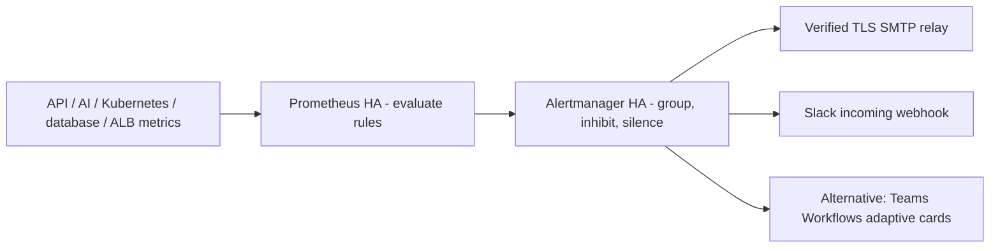

# Asteriq Alertmanager

Prometheus evaluates the canonical `../prometheus/asteriq-alerts.yaml` rules and
sends alerts to the two operator-managed Alertmanager replicas. Alertmanager
groups and inhibits related alerts, then notifies email and Slack. The complete
Teams Workflows alternative is `alertmanager-teams.example.yaml`.



## Alert coverage

| Condition                                        | Severity           | Persistence                                                           |
| ------------------------------------------------ | ------------------ | --------------------------------------------------------------------- |
| API 5xx >5%                                      | critical           | 5 minutes, >0.1 requests/sec                                          |
| API 5xx >2%                                      | warning            | 5 minutes, same traffic guard                                         |
| API p95 >1 second                                | warning            | 10 minutes                                                            |
| Container restarts increasing                    | warning            | 2 minutes, 10-minute increase window                                  |
| CrashLoopBackOff                                 | critical           | 3 minutes                                                             |
| Node CPU >80% / >95%                             | warning / critical | 10 minutes                                                            |
| Node memory >85% / >95%                          | warning / critical | 10 minutes                                                            |
| Pod CPU >80% / memory >85% of limits             | warning            | 10 minutes; positive limits required                                  |
| AI service unavailable or missing scrape targets | critical           | 3 minutes; expected deployment required                               |
| PostgreSQL connections >80% / >90% of maximum    | warning / critical | 5 minutes                                                             |
| PostgreSQL unavailable                           | critical           | 3 minutes                                                             |
| API Redis probe failed                           | critical           | 2 minutes                                                             |
| Failed trading requests increasing               | warning            | 3 minutes; >5 failures in 5 minutes and greater than preceding window |
| Trading failure ratio >10%                       | critical           | 5 minutes; >4 order attempts/minute                                   |
| Ingress error rate more than doubled             | warning            | 2 minutes; minimum error volume                                       |
| ALB/target 5xx >5%                               | critical           | 5 minutes; at least 5 errors in the period                            |
| Node not Ready                                   | critical           | 5 minutes                                                             |
| Pod remains Pending                              | info               | 15 minutes                                                            |

Prior disk, LLM, inference, database-latency and deployment alerts are retained
in this canonical resource. Old `rules.yaml` and `dashboard-alerts.yaml` keep
their existing resource identities with recording rules, removing duplicate
alert definitions without requiring a destructive resource prune. Overlapping
stock crash-loop/node-not-ready alerts are disabled in the monitoring values.
Review other stock kube-prometheus-stack alerts for organization-specific noise.

API latency includes all non-health operations, including research. The existing
Grafana core-latency panel excludes research; use the matching operation selector
when investigating this total-API alert. Trading failures include validation,
authentication and aborted HTTP requests, not only execution-engine errors.
AI availability measures process/HTTP scrape availability, not every optional
model/provider configuration. Redis is the API's periodic connectivity probe,
sampled every minute; it exports NaN until its first result. PostgreSQL connection
alerts need the existing postgres-exporter profile and settings metrics. Set a
lower usable connection ceiling when reserved slots or provider limits require it.

## Activate routing securely

1. Configure actual SMTP host, sender, username, recipient and Slack channel in
   `alertmanager.example.yaml`, or select the Teams file. Use an approved SMTP
   relay with verified TLS. Keep Alertmanager UI/API private and restrict silence
   administration to on-call operators.
2. Provision `asteriq-alertmanager-config` in `monitoring`, key
   `alertmanager.yaml`, containing that reviewed configuration. The chart uses
   `useExistingSecret` and `alertmanagerSpec.configSecret`; it does not embed
   credentials in Helm values/history.
3. Provision `asteriq-notification-credentials` with `smtp-password` and
   `slack-webhook`. For Teams replace the Slack key with `teams-webhook` and use
   the matching receiver configuration. These files are mounted under
   `/etc/alertmanager/secrets/asteriq-notification-credentials/`.
4. The external-secret example reads both configuration and credentials from a
   scoped AWS Secrets Manager store. Replace the store/secret ARN and configure
   matching External Secrets CRDs/IAM. For Teams change `slack_webhook` property
   to `teams_webhook`. Never commit passwords or webhook URLs.
5. Configure unique `externalLabels.cluster` and `externalLabels.environment`
   for each Prometheus installation. Replica labels are dropped before sending
   alerts so HA Prometheus copies have the same Alertmanager fingerprint.
6. Reconcile monitoring values and the Prometheus Kustomization through Argo CD.
   Existing GitOps monitoring children consume both. Prepare the Secrets before
   upgrading; a missing configuration/credential Secret blocks startup. Production
   retains its manual sync/review controls.

Allow Prometheus → Alertmanager:9093, Alertmanager peer gossip TCP/UDP:9094,
DNS, approved SMTP:587 and webhook HTTPS:443. Persistent 2GiB volumes retain
silences/notification state. HA deduplication is best effort during partitions;
it is not exactly-once delivery. Do not put financial payloads, user IDs or JWTs
in alert labels/annotations or notification templates.

## Grouping and inhibition

Groups use cluster, environment, namespace, service, alert name and severity.
Pod/instance alerts of the same kind are batched instead of sending one message
per pod. Default group wait is 45 seconds, update interval 5 minutes, repeat
interval 4 hours. Critical repeats hourly; info batches for 30 minutes and
repeats daily. Resolved notifications are enabled.

All three severities notify email and the selected chat integration. Info alerts
use the longer batching/repeat intervals above to keep advisory messages quiet.
The stock `InfoInhibitor` helper routes to null because it is an inhibition
signal rather than an operational incident. Teams Workflows uses native
`msteamsv2_configs`; select Alertmanager 0.28.0 or newer and pin an approved
kube-prometheus-stack chart version before deploying.

Critical alerts suppress warning/info only within the same nonempty alert family
and matching resource scope. Separate clusters, namespaces, ALBs, pods, instances,
jobs and operations cannot suppress each other. Node-unavailable alerts inhibit
restart/crash-loop symptoms only on that node, using joined kube_pod_info labels.
Crash loops inhibit restart noise for the same namespace/pod. Unrelated critical
alerts remain visible. Maintenance uses scoped, expiring silences, with an owner
and reason; avoid blanket production mutes.

The stock Watchdog receiver is null in the example. Connect it to an approved
external dead-man monitor before relying on notifications to detect failure of
Prometheus or Alertmanager itself. Monitor notification failures/retries and
configuration reload errors, and confirm receiver delivery after setup.

## Ingress inputs

For the current AWS ALB architecture, install a pinned
`prometheus-cloudwatch-exporter` chart using
`alb-cloudwatch-exporter-values.example.yaml`. Configure the actual ALB suffix,
AWS region and scoped IRSA role from the read-policy example. It requires no
static AWS access keys. Enable its ServiceMonitor with the provided selection
label and verify metric names against the selected exporter.

The ALB rules use five-minute CloudWatch Sum **gauges**, not Prometheus counter
rates. Errors combine ELB-generated and target-generated 5xx; the denominator
accounts for ELB failures not forwarded to a target. Sparse missing error
series fall back to zero only when a request series exists. CloudWatch delay
adds detection latency; confirm exporter freshness and dimensions. One exporter
per target prevents duplicated sums. The nginx-controller rule is for clusters
that actually run an ingress controller exposing
`nginx_ingress_controller_requests`; it does not invent an Nginx metric for ALB.
Missing ingress/exporter inputs yield no ingress alert, so verifying discovery
and required dependencies is an activation gate.

## Verification

```powershell
python scripts/monitoring/validate_alerts.py --promtool PATH_TO_PROMTOOL --amtool PATH_TO_AMTOOL
```

This exports Kubernetes rules into native Prometheus rule files, runs synthetic
firing/low-traffic cases, validates both configurations and dry-runs severity
routing. It never sends notifications. Tests include resource-scoped inhibition
and credential-file usage. Configure real destinations, then use an authorized
synthetic alert to verify delivery and recovery before production activation.

References: [Alertmanager configuration](https://prometheus.io/docs/alerting/latest/configuration/),
[Prometheus rule testing](https://prometheus.io/docs/prometheus/latest/configuration/unit_testing_rules/).
