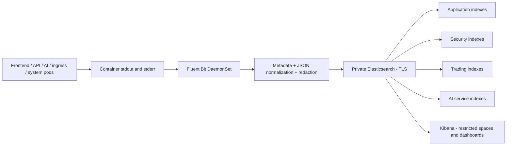

# Elasticsearch / Fluent Bit / Kibana

Install a pinned Elastic Cloud on Kubernetes operator and its CRDs before applying
this Kustomization. Replace the matching Elastic version and StorageClass.
`base/elastic.yaml` defines three Elasticsearch nodes and two Kibana replicas.

ECK manages HTTP TLS and initial authentication Secrets. Keep endpoints private,
define lifecycle/snapshots, and use dedicated ingest/search identities instead
of a superuser. Mmap is disabled to avoid a privileged sysctl initializer in
this example; review production performance and node-level kernel settings.

The implemented collector is a Fluent Bit DaemonSet. The older Logstash pipeline
remains an unused alternative example. Fluent Bit tails node-local containerd
logs, enriches Kubernetes metadata, normalizes/redacts JSON through Lua and sends
records over verified TLS to Elasticsearch. It uses filesystem buffering and a
dedicated ingestion identity loaded from Secrets, not an Elasticsearch superuser.

Choose ELK instead of Loki when search requirements justify it. Application
overlays install neither stack. See the
[ECK deployment guide](https://www.elastic.co/docs/deploy-manage/deploy/cloud-on-k8s).



## Layout and setup

`base/elastic.yaml` supplies three Elasticsearch nodes with zone spread and two
Kibana replicas. `base/fluent-bit.yaml`, `base/fluent-bit.conf` and `base/normalize.lua` supply
the collector. `environments/{dev,staging,production}` select its environment.
`elasticsearch/` contains index templates, lifecycle policies and scoped roles.
`kibana/asteriq-dashboards.ndjson` contains five dashboards, twenty panels and
five data views with internal references.

1. Install a reviewed, pinned ECK operator/CRDs. Replace the Elastic version,
   Fluent Bit image version (prefer a verified digest), and StorageClass. This
   profile assumes three zones/nodes with sufficient memory. Review a smaller
   development node topology explicitly if using a local/single-zone cluster.
2. Prepare `monitoring` and the dedicated `logging-agents` namespace. Its example
   is at `k8s/namespaces/logging-agents/namespace.yaml`. The collector needs root
   to read node log files and a read-only `/var/log` hostPath, plus a writable
   hostPath only for offsets/buffers. It drops all capabilities, forbids privilege
   escalation and keeps its root filesystem read-only. Restrict namespace
   administration: its Pod Security exception is intentional for host logging.
   This DaemonSet requires EC2/containerd workers; it cannot run on EKS Fargate.
3. Reconcile the selected environment through the optional Argo Application in
   `gitops/app-of-apps/alternatives/elk/<environment>/`. Apply its separate
   AppProject administratively first. These files do not replace the active Loki
   child until selected; choose one logging ownership path. Stop Alloy when
   switching to Fluent Bit unless duplicate collection is deliberately reviewed.
4. Once ECK is healthy, run the index bootstrap below using an administrative
   API key with reviewed template/ILM/security/index permissions. Do not give
   those permissions to Fluent Bit. Create a dedicated writer identity assigned
   the generated environment-specific writer role.
5. Provision `elasticsearch-log-writer` in `logging-agents`, with `username` and
   `password`, through the secret controller. Mirror ECK's **public** HTTP CA
   from `asteriq-logs-es-http-certs-public` in `monitoring` into
   `elasticsearch-log-ca` in `logging-agents`, key `ca.crt`, with rotation handling.
   The collector intentionally remains Pending until those dependencies exist.
6. Import dashboards into a restricted Kibana space. Assign reviewed Kibana
   space privileges alongside the supplied Elasticsearch reader roles. General
   log readers exclude security indexes; security reviewers get a separate role.

Examples, run from an authorized workstation with private connectivity:

```powershell
# API keys come from the managed secret mechanism, never committed files.
python scripts/monitoring/bootstrap_elasticsearch.py --url https://YOUR_ELASTICSEARCH --ca PATH_TO_ES_CA --environment production
python scripts/monitoring/import_kibana.py --url https://YOUR_KIBANA --ca PATH_TO_KIBANA_CA --space asteriq-production
```

The scripts read `ELASTIC_BOOTSTRAP_API_KEY` and `KIBANA_IMPORT_API_KEY`
respectively, enforce CA-verified HTTPS and do not print credentials or response
payloads. Kibana import uses `overwrite=true` for the fixed Asteriq object IDs;
review the destination space before running it. These scripts are not executed
against a live cluster during repository setup. CI never deploys application
workloads with kubectl.

## Indexes, routing and retention

| Category    | Daily index pattern                            | Retention |
| ----------- | ---------------------------------------------- | --------- |
| Application | `asteriq-<environment>-application-YYYY.MM.DD` | 30 days   |
| Security    | `asteriq-<environment>-security-YYYY.MM.DD`    | 90 days   |
| Trading     | `asteriq-<environment>-trading-YYYY.MM.DD`     | 90 days   |
| AI service  | `asteriq-<environment>-ai-YYYY.MM.DD`          | 30 days   |

Bootstrap installs policies/templates/roles and creates today's four indexes.
Subsequent daily indexes are created by ingestion under the templates. Each
index has one primary shard and one replica; tune shards/retention to measured
volume and approved policy, and snapshot before deletion. Daily indexes use
delete-only ILM; this design does not pretend daily naming is rollover/data-stream
management. A one-node development cluster needs an explicitly reviewed replica
setting rather than accepting permanently unassigned replicas.

Routing is exclusive: authentication/authorization/rate-limit/security events
first, then order/trade endpoints, then AI service events, then application logs.
Both `authentication_*` and `authorization_*` event families route to security,
including successful authentication events emitted without an HTTP endpoint.
A rejected order with HTTP 401 goes to security, not both security and trading.
The API/trade/AI failure dashboards search the combined data view to include
cross-category failures. Security events are operational signals, not a complete
tamper-evident audit trail or automated threat detector.

Mappings are strict and include `@timestamp`, namespace/pod/node/container,
service/environment, severity, event, route template, status_code, request_id,
trace_id and optional user_safe_identifier. Status codes are coerced to valid
integers; raw Kubernetes labels and unknown payload fields are not indexed.
Correlation IDs and pseudonyms remain searchable keyword fields. Bodies,
credentials, raw user IDs and arbitrary structured payloads are discarded;
message redaction covers common Bearer/URL/query/email patterns. Inspect actual
third-party messages for PII: pattern redaction is defense in depth, not a proof.
Unknown namespace metadata fails closed (dropped); monitor metadata/filter errors.

Decoded application JSON is kept under a separate intermediate key, so it cannot
overwrite trusted Kubernetes namespace/pod metadata. Kustomize hashes collector
ConfigMap contents and updates the DaemonSet reference, triggering a rolling
restart on configuration changes. Roll out collectors after credentials or CA
trust changes as well.

## Kibana dashboards

| Dashboard               | Panels                                                                  |
| ----------------------- | ----------------------------------------------------------------------- |
| Authentication activity | Matching events, timeline, HTTP status breakdown, environment breakdown |
| API errors              | Error count, timeline, affected endpoints, environments                 |
| Trade errors            | Rejected order/trade count, timeline, endpoints, environments           |
| AI failures             | Failure count, timeline, failure events, environments                   |
| Security events         | Security-event count, timeline, event types, environments               |

The assets use aggregation-based visualizations and saved-object references.
Validate import/migration on the selected Kibana version before production; no
live Kibana compatibility is claimed from JSON validation alone. Filter by
`environment`/`namespace` in the dashboard, then investigate `request_id` or
`trace_id` in Discover. Counts are log events, not unique users, orders or trades.
Examples of KQL: `event:authentication_failure`, `service:api and status_code >= 500`,
`event:trade_failure`, `service:ai-service and status_code >= 500`, and
`category:security and status_code:429`.

## Operations and verification

Fluent Bit tails each node once, excludes logging-stack feedback, limits memory
and buffers up to 2GiB per output on persistent node storage. Retries are unlimited
but storage is bounded: prolonged outages, node loss, long-line skipping and
buffer exhaustion can lose logs. Generated document IDs reduce bulk-retry
duplicates; they do not provide exactly-once delivery after arbitrary replay.
Monitor ingestion failures, dropped records, disk capacity, Elasticsearch health,
replica allocation and ILM errors. Restrict collector egress to API/DNS/ES, query
access to approved viewers, and port 2020 to monitoring. Keep ES/Kibana private.
Do not use log counts as the trading ledger or immutable compliance audit store.

Web logs are Nginx container logs, not browser-console telemetry. Ingress/system
pod logs are collected; AWS ALB access logs, EKS managed control-plane logs and
host journald need separate sources. The configured index role is write-only
with `create_doc`/`auto_configure`, and bulk output explicitly uses create actions.

Validation includes executable Lua routing/redaction cases, saved-object
reference checks, strict mappings, and Kubernetes rendering. Live Fluent Bit
plugin compatibility, Elasticsearch ingestion, Kibana import and notification
delivery must be verified after target versions and credentials are configured.

```powershell
python -m pip install -r scripts/monitoring/requirements-test.txt
python -m pytest scripts/monitoring/tests/test_elk.py -q
kubectl kustomize k8s/monitoring/elk/environments/production
```

Rendering is local and does not deploy workloads. The tests cover frontend,
API, ingress and system container sources, AI routing, security precedence,
redaction, metadata spoofing, dashboard references and decoded KQL strings.

References: [Fluent Bit Elasticsearch output](https://docs.fluentbit.io/manual/data-pipeline/outputs/elasticsearch.md),
[Kibana saved-object import](https://www.elastic.co/docs/api/doc/kibana/operation/operation-post-saved-objects-import).
