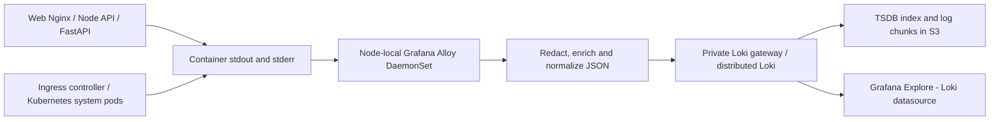

# Loki profile

The chart values provide distributed Loki, TSDB/v13 and S3 without embedded
MinIO or AWS access keys. Replace buckets, region and a scoped IRSA role, then
select a tested chart version from its currently supported repository. Plan
compactor retention, bucket lifecycle, zone replication, persistence and tenant
budgets for that version; this profile does not supply deployment-specific values.

`alloy.example.alloy` discovers application, ingress, cert-manager, monitoring
and kube-system pods, then streams their logs to the private gateway. The
DaemonSet discovers only pods on its own node using `NODE_NAME`; it does not
duplicate every cluster stream on every node. Its own Alloy/Loki pods are excluded
to prevent feedback loops. `alloy-values.example.yaml` and environment values
configure the Downward API, resources and dedicated `asteriq-alloy` account.
This Kustomization also provides least-privilege pod discovery/log RBAC, with
the chart's default RBAC disabled. No cluster is contacted merely by adding files.

This Kustomization generates the `asteriq-alloy` ConfigMap from that file for an
external Helm-managed collector to mount. Its name is stable for that reference;
reload or roll out the collector deliberately after configuration changes.

Loki `auth_enabled` enables tenancy, not caller authentication. Restrict gateway
access and use authentication; separate production log permissions as needed.
Do not use user IDs, JWTs, order IDs or trace IDs as high-cardinality labels.
Redact sensitive payloads at application and collection boundaries. See
[Loki deployment modes](https://grafana.com/docs/loki/latest/setup/install/helm/concepts/)
and [Grafana Alloy](https://grafana.com/docs/alloy/latest/).

## Architecture and provisioning



The existing App-of-Apps logging Application installs Loki, Alloy and this
Kustomization. Select tested, pinned chart versions and replace S3 bucket, IRSA,
storage class and cluster settings before enabling synchronization. For a
standalone installation, reconcile this Kustomization and install the Alloy
chart using its example values. The chart's ServiceAccount must match the RBAC
subject. Roll out or reload after collector changes; ConfigMap names are stable.
Production synchronization remains manual.

The RBAC account can read pod metadata/logs across the cluster. The discovery
namespace allowlist controls collection, not authorization; treat this account
as a privileged log reader and restrict its administration to platform owners.

Allow the collector to reach Kubernetes API:443, DNS and private Loki gateway.
Grafana needs gateway query access. Keep the gateway private and use scoped
gateway authentication/TLS when crossing trust boundaries; tenant headers alone
are not authentication. IRSA must grant only required log-bucket operations,
including compactor deletion. Retention defaults are dev 7 days, staging 14 days,
production/example 90 days, with a persistent compactor working directory.
Configure compatible bucket lifecycle, encryption and approved viewer roles.

React is served by Nginx: the web container emits JSON access logs and native
Nginx error logs. Browser console logs do not reach container stdout and require
a separately reviewed browser telemetry SDK. The ALB controller runs in
kube-system and is collected; AWS ALB access logs are an S3 source, not pod logs.
Managed EKS control-plane logs and host/journald logs likewise require separate
CloudWatch or host collectors. This pipeline collects Kubernetes **pod** logs.

## Structured fields and privacy

Every normalized Loki record includes `timestamp`, `service`, `environment`,
`namespace`, `pod`, `level`, `request_id`, `trace_id`, `user_safe_identifier`,
`endpoint`, and `status_code`, plus `message`, `event`, and `container`.
Discovery supplies trusted inventory metadata. Only namespace, service,
environment, node, container and bounded severity become Loki index labels. Pod,
request/trace identifiers, users and endpoints stay in JSON bodies.

API and AI emit structured JSON with snake_case correlation fields. Legacy
camelCase fields remain for compatibility and the collector accepts both.
HTTP endpoints are route templates, not raw request URLs. Nginx uses bounded
`/api/*`, `/socket.io/*`, `/health` or `web` categories and omits query strings.
Native/system logs are wrapped into JSON; unavailable HTTP/correlation fields
are empty rather than fabricated. When a producer has no structured timestamp,
the normalized field uses collection time; Loki retains the original stream
timestamp. Unknown severity remains `unknown` instead of treating every stderr
line as an error. JSON message/msg and supported native error prefixes are used.

The API can emit a stable 24-character HMAC pseudonym when an externally managed
`LOG_USER_HASH_KEY` of at least 32 characters is supplied in `api-secrets`.
Without that optional key, user correlation is null. AI uses null because no
trusted user-identity logging context is instrumented there. Never log raw user
IDs, email addresses, order payloads, prompts, portfolio values or credentials.
Keep the HMAC key separate from JWT signing keys and rotate under a reviewed
correlation-retention policy. Collector redaction covers common credential JSON
fields, Bearer tokens, sensitive query parameters, email patterns and credential-bearing database/cache/mail URLs; it is
defense in depth, not a guarantee that arbitrary third-party logs contain no PII.
Validate third-party log samples before granting production access.

## Grafana queries and validation

Use [the LogQL query catalog](logql.md) for errors, HTTP 500, authentication,
AI failures, trade failures, database failures, trace correlation and error rates.
The existing Grafana datasource already selects Loki tenant `asteriq`.
API query failures log only exception type, never SQL text or bound values.
HTTP completion events cover auth/rejected trade failures even at info severity.

A repeatable local-only smoke check is available:

```powershell
python scripts/monitoring/smoke_logging.py --alloy PATH_TO_APPROVED_ALLOY_EXECUTABLE
```

It binds localhost, disables reporting, feeds synthetic structured/native logs,
asserts normalized fields/redaction/index-label safety, then stops the process.
It does not contact Kubernetes or Loki. The pipeline was validated with the
official checksum-verified Alloy 1.20.1 CLI.

Validate `alloy.example.alloy` with the approved Alloy CLI's `validate` command,
render the Kustomization, run application logging tests, then verify one test
request's trace across web/API/AI in Grafana Explore. Check collection errors,
dropped/retried writes, ingestion volume and retention before production use.
API-tail collection avoids privileged host mounts but increases kubelet/API
traffic; load-test the collector and consider reviewed file-tail collection for
very large clusters. Restarts/disconnections may miss or replay lines; Loki is
operational telemetry, not the immutable financial audit trail.
