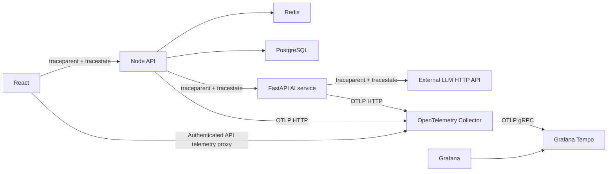

# Asteriq distributed tracing

The implemented backend is Grafana Tempo. React, Node and FastAPI export OTLP
traces through the OpenTelemetry Collector; Grafana queries Tempo by trace ID.



Redis and PostgreSQL are client spans under the API request. They do not relay
HTTP headers to the AI service. Requests show whichever dependencies they
actually use, including parallel calls, cache hits and skipped operations.

## Instrumentation

| Component | Instrumentation | Span |
| --- | --- | --- |
| React | API-scoped fetch wrapper | `web.http.request` |
| Node HTTP | Express request middleware and OTel async context | `http.server` |
| Redis | Client and transaction wrappers | `redis.operation`, `redis.transaction` |
| PostgreSQL | Pool client query wrapper | `postgresql.query` |
| Node to AI | Research and RAG HTTP gateways | `ai.request` |
| FastAPI | OpenTelemetry FastAPI/ASGI instrumentation | `http.server` |
| Python PostgreSQL | psycopg instrumentation, when installed | `postgresql.query` |
| AI provider | Research/embedding operation spans | `llm.request`, `ai.embeddings` |
| Python outbound HTTP | HTTPX instrumentation | `http.client` |

SQL text, Redis keys/values, prompts, request bodies, authentication headers and
exception payloads are excluded. Python applies an exporter privacy boundary;
the Collector applies a second attribute allowlist. Application logs expose the
active trace ID, and HTTP responses provide `X-Trace-Id` for investigation.

## Node to Python context propagation

1. React starts a client span and injects W3C headers into the API fetch request.
2. Node extracts `traceparent` and optional `tracestate` into an OTel context and
   creates a server span. Async context keeps that span active across awaits.
3. Redis, PostgreSQL and AI request spans inherit that context. Inside the AI
   request span, `traceHeaders()` injects its current context into the HTTP call.
4. FastAPI instrumentation extracts those headers and creates a Python server
   span whose parent is the Node AI client span. HTTPX repeats injection for the
   external LLM request.

`traceparent` contains version, a 32-hex-character trace ID, a 16-hex-character
parent span ID and sampling flags, for example:

```text
00-aaaaaaaaaaaaaaaaaaaaaaaaaaaaaaaa-bbbbbbbbbbbbbbbb-01
```

The trace ID stays the same; every operation gets its own span ID. `tracestate`
preserves optional vendor context. Invalid parents start a new trace. Parent-based
sampling preserves upstream decisions; a sampled parent remains sampled in Python.
Headers identify trace ancestry and are never authorization credentials.

An external LLM may ignore W3C headers. Asteriq still records its outbound client
span, duration and failure status; provider-internal spans require provider support.

See [OpenTelemetry propagation](https://opentelemetry.io/docs/concepts/context-propagation/)
and [Collector to Tempo](https://grafana.com/docs/tempo/latest/set-up-for-tracing/instrument-send/set-up-collector/otel-collector/).

## Activate

1. Pin an approved Collector Contrib image in `base/resources.yaml`. Deploy Tempo
   using a reviewed, pinned `tempo-distributed` chart and
   `tempo-values.example.yaml`; supply the bucket, region, IRSA role and storage
   class. The included example retains traces for 72 hours.
2. Reconcile `tls/` for a TLS OTLP receiver. Provision the certificate Secret
   referenced in `tls/deployment.yaml` using `collector-certificate.example.yaml`
   and your issuer. The Collector-to-Tempo example uses private plaintext gRPC;
   configure verified TLS there if your transport policy requires it. `base/`
   provides a private HTTP receiver for explicitly selected non-TLS environments.
3. Merge `application-values-tls.example.yaml` into the platform chart values and
   apply `application-network-policies.yaml` for the selected namespaces. Supply
   `tracing-client-ca` in each application namespace, containing the required
   combined CA bundle. Set `ASTERIQ_ENVIRONMENT` for both services.
4. Rebuild React with `VITE_TRACING_ENABLED=true` and the actual `VITE_API_URL`.
   These are Vite build-time values. Browser OTLP batches go through the bounded,
   authenticated API telemetry proxy; the Collector is never exposed publicly.
   Browser batches without an access token are discarded, while header
   propagation still enables correlation with API spans.
5. Import the Tempo datasource from `base/tempo-datasource.yaml` through the
   existing Grafana sidecar. Keep Collector, Tempo and Grafana access private.

Node/Python root sampling defaults to 10% via `OTEL_TRACE_SAMPLE_RATIO`; React
also samples 10% of roots. Set the backend ratio to `1` for a controlled staging
verification. SDK queues, Collector memory and export retries are bounded.
Collector restart or a prolonged backend outage can lose buffered spans.

## Verification

```powershell
node --import tsx --test apps/api/tests/tracing.test.ts
npm run typecheck --workspace @asteriq/api
# From apps/ai-service with its requirements installed:
python -m pytest tests/test_tracing.py -q
# Local manifest rendering only:
kubectl kustomize k8s/monitoring/tracing/tls
```

Tests check Node Redis/PostgreSQL/AI ancestry, Python FastAPI-to-mock-LLM ancestry,
shared trace IDs, propagated tracestate and sensitive-attribute exclusion. These
are local component tests, not a live full-stack deployment test.

After deployment, issue an authenticated React research request, copy its
`X-Trace-Id`, and search it in Grafana Explore's Tempo datasource. Confirm React,
API, dependencies, Python and LLM client spans share that ID. Exercise cache-hit,
cache-miss and provider-error cases. Verify Collector export failures and Tempo
ingestion before relying on production traces.
